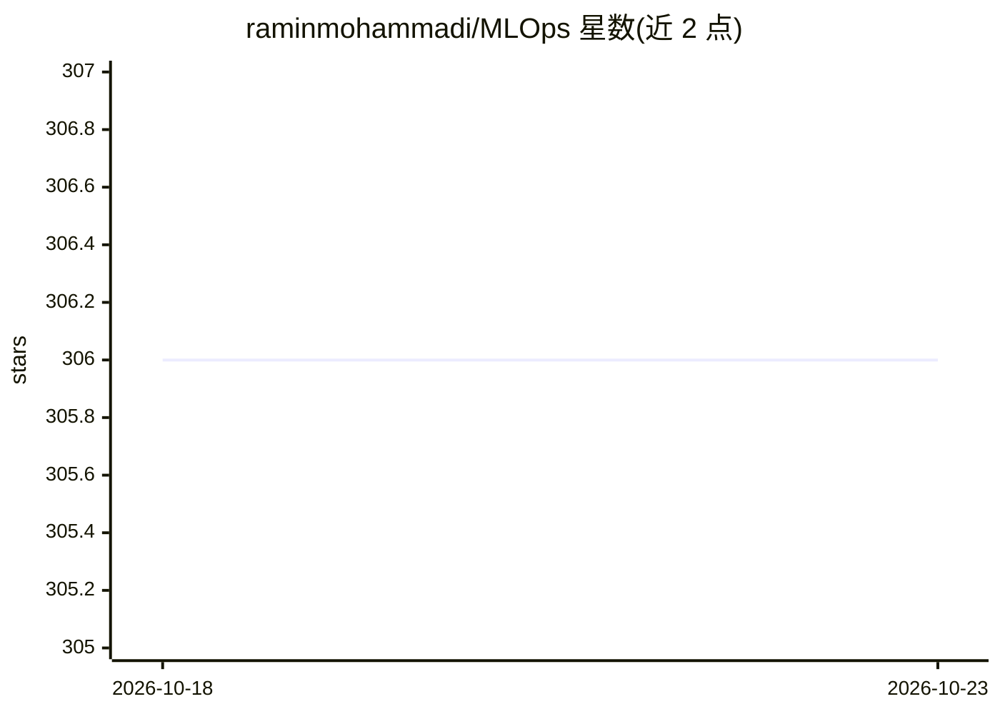

# raminmohammadi/MLOps

⭐ 306 · Jupyter Notebook · CC0-1.0 · 推送 2026-10-11 · [GitHub](https://github.com/raminmohammadi/MLOps) · [官网](https://www.mlwithramin.com/) · 组织维护

**东北大学 MLOps 课程的实验与阅读材料仓库**

Northeastern University DADS 7305 MLOps 课程的教学资源仓库，收录课程阅读材料、实验（labs）与练习代码，主题覆盖端到端 ML 流水线构建、模型生产部署、ML 系统监控与再训练、CI/CD/CM/CT、容器化编排，以及 LLMOps（LLM 评测、对齐、监控与规模化部署）。面向课程学生与教师，也开放给任何对 MLOps 感兴趣的学习者；使用方式为克隆仓库后按实验顺序自学，部分阅读材料收集自 Coursera（CC 许可）。

## 筛选速览

| 维度 | 判定 | 备注 |
|---|---|---|
| AI 角色 | `ai-knowledge` | 知识聚合/清单类 |
| 许可风险 | `viral` | CC0-1.0 |
| 部署形态 | `None` |  |
| 模型依赖 | — | README 未给出锁定关系 |
| 硬件要求 | — | 无带数字的原话,不猜 |
| 安装摩擦 | `low` | 无编译、无系统依赖或容器化 |
| 成熟度 | — | 结构信号不足 |

## 能力要点

- 覆盖传统 ML 与 LLM 的 MLOps/LLMOps 实验序列
- 主题含 CI/CD/CM/CT、容器化编排、数据漂移与再训练
- 每个实验附带说明文档与代码示例
- 阅读材料来自 Coursera（Creative Commons 许可）

## 适用场景

- 按顺序自学 MLOps 全生命周期实践
- 课程学生获取实验与阅读材料
- 了解 LLMOps 的评测、对齐与监控做法

## 场景标签

`教程课程` `MLOps` · 领域:学习与行业

## 证据(README 行号)

> L7: Welcome to the MLOps Repository! This repository is dedicated to sharing reading contents, labs and exercises for th
> L13: MLOps is an emerging discipline that focuses on the collaboration and communication of both data scientists and IT 

## 星数曲线

2026-10-18 306 → 2026-10-23 306（+0）

---
*卡片 v1 · prompt 1.4 · 生成 2026-10-21 · 置信度 high · 依据 README sha `0eec1c063ffd` · [字段定义](../../DATASET.md)*
