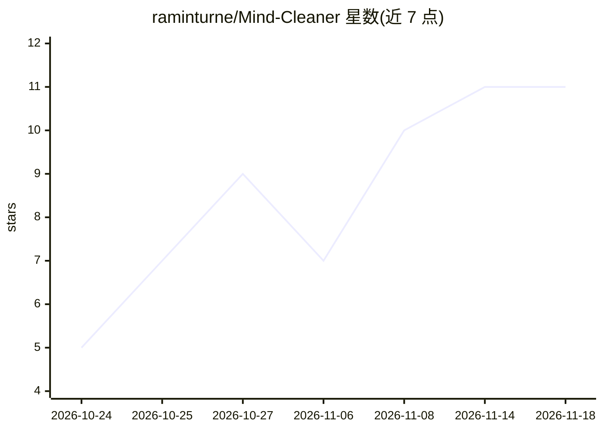

# raminturne/Mind-Cleaner

⭐ 11 · JavaScript · MIT · 推送 2026-11-15 · [GitHub](https://github.com/raminturne/Mind-Cleaner) · 个人维护

**本地优先思维导图桌面应用，内置 AI 生成子节点**

基于 Rust + Tauri 的本地优先思维导图桌面画布，前端无依赖打包。核心为思维节点的创建、编辑、拖拽重组、附件管理与 PNG/JSON 导出；AI 功能通过节点菜单生成子节点、改写单个节点内容，草稿需确认并支持撤销。接入 OpenRouter、OpenAI、Google AI Studio、Anthropic 与自定义/Ollama 端点，支持模型发现与故障自动换模型；Windows 下密钥用系统账户加密保存。需 Node.js 20+，桌面开发需 Rust 与 Tauri 前置条件。

## 筛选速览

| 维度 | 判定 | 备注 |
|---|---|---|
| AI 角色 | `ai-enhanced` | 去掉 AI 部分产品仍成立 |
| 许可风险 | `permissive` | MIT |
| 部署形态 | `library` | 以包/库形式分发 |
| 模型依赖 | local-ok | 支持本地模型 |
| 硬件要求 | — | 无带数字的原话,不猜 |
| 安装摩擦 | `low` | 无编译、无系统依赖或容器化 |
| 成熟度 | — | 结构信号不足 |

## 能力要点

- AI 生成子节点与单节点改写，草稿需接受、可撤销
- 多端点接入：OpenRouter、OpenAI、Google AI Studio、Anthropic、自定义/Ollama
- 模型发现与可用性/限流错误后自动换模型
- 本地优先持久化，支持便携模式与旧格式 JSON 地图导入

## 适用场景

- 本地管理个人思维导图与附件
- 用 AI 为某个想法批量生成子节点
- 从 PromptPad 导入已有的 API 密钥与模型配置
- 导出 JSON/PNG 分享地图

## 场景标签

`知识库管理` · 领域:知识与检索

## 证据(README 行号)

> L3: A local-first desktop canvas for connected thoughts. Built with Rust + Tauri and a dependency-free frontend. It reop
> L38: ## AI
> L40: Use a thought’s **+ → AI** to generate children, including a requested count in your prompt. **Right-click → Edit w

## 星数曲线

2026-10-24 5 → 2026-11-18 11（+6）

---
*卡片 v1 · prompt 1.4 · 生成 2026-11-18 · 置信度 high · 依据 README sha `c952dc4f7e74` · [字段定义](../../DATASET.md)*
