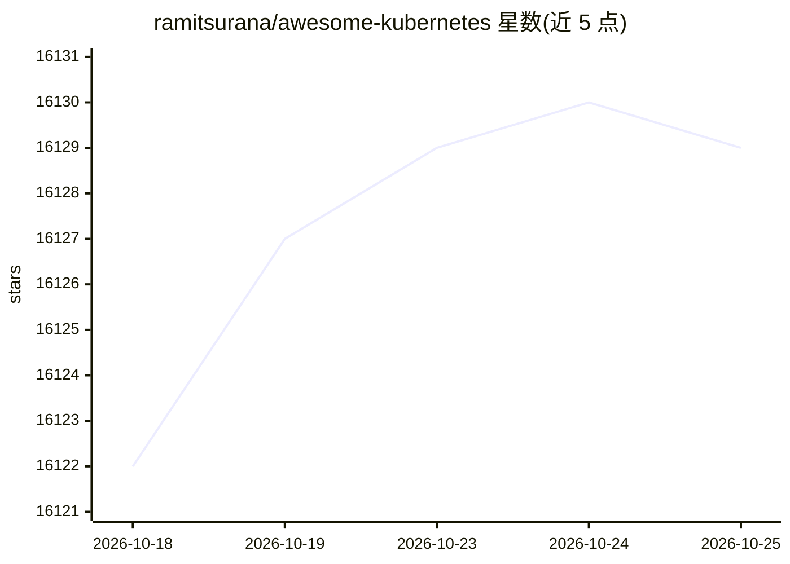

# ramitsurana/awesome-kubernetes

⭐ 16,129 · Shell · NOASSERTION · 推送 2026-10-21 · [GitHub](https://github.com/ramitsurana/awesome-kubernetes) · [官网](https://ramitsurana.github.io/awesome-kubernetes) · 个人维护

**Kubernetes 学习资源与工具的精选链接清单**

由 @sindresorhus 的 awesome 系列启发的 Kubernetes 资源精选清单，收录入门概念介绍、历史背景、教程文章、书籍与部署指南等链接。内容提供 Gitbook 电子书形式下载阅读，配有 Links Validator、Python 应用等自动化校验机制；清单接受社区贡献，对不再维护或不合适的条目欢迎提交 pull request 更新。

## 筛选速览

| 维度 | 判定 | 备注 |
|---|---|---|
| AI 角色 | `ai-knowledge` | 知识聚合/清单类 |
| 许可风险 | `none` | NOASSERTION |
| 部署形态 | `None` |  |
| 模型依赖 | — | README 未给出锁定关系 |
| 硬件要求 | — | 无带数字的原话,不猜 |
| 安装摩擦 | `low` | 无编译、无系统依赖或容器化 |
| 成熟度 | — | 结构信号不足 |

## 动量与使用信号

- 维护:`active` — 距上次 push 26.9 天,年发版 0,377 位贡献者
- 涨星:近 1 天 **-1**(自 20261016 起算)
- 平台:LINUX · 协议:—

## 能力要点

- 精选 Kubernetes 教程、书籍与部署指南链接
- 提供 Gitbook 电子书形式阅读
- Links Validator 自动校验链接有效性
- 社区贡献机制维护清单内容

## 适用场景

- 查找 Kubernetes 入门与概念学习资料
- 检索特定场景（CentOS/Ubuntu/Windows）的集群部署教程
- 了解 Kubernetes 生态工具与书籍推荐

## 场景标签

`精选清单` · 领域:学习与行业

## 证据(README 行号)

> L10: A curated list for awesome kubernetes sources inspired by @sindresorhus' awesome
> L21: **Thanks to Gitbook.This awesome list can now be downloaded and read in the form of a book. Check it out --> https:

## 星数曲线

2026-10-18 16,122 → 2026-10-25 16,129（+7）

---
*卡片 v1 · prompt 1.4 · 生成 2026-10-18 · 置信度 mid · 依据 README sha `a787e74f82d5` · [字段定义](../../DATASET.md)*
