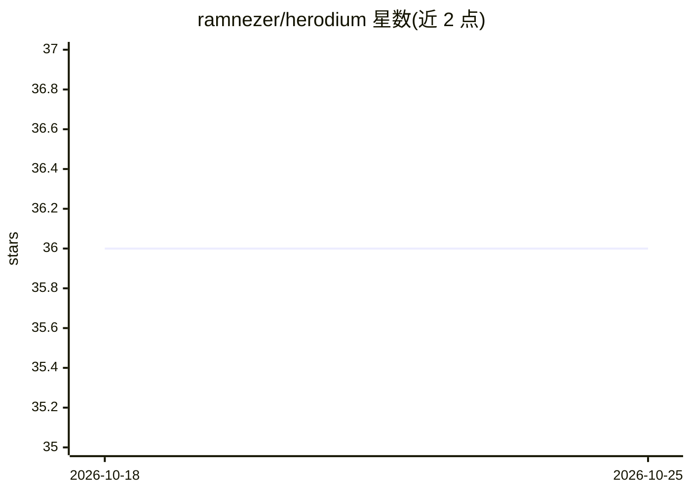

# ramnezer/herodium

⭐ 36 · Python · MIT · 推送 2026-08-26 · [GitHub](https://github.com/ramnezer/herodium) · 个人维护

**开发者向 Linux 防御工具种子框架：整合多层防护组件**

以特权后台引擎形式运行的 Debian 系 Linux 安全框架，作为构建和测试防御工具的种子基础：实时文件监控、USB 媒体扫描、进程与命令行检查（ClamAV 后端扫描并终止染毒进程）、可选 Falco eBPF 运行时行为告警、Maltrail 网络监控（可经 iptables/ipset 阻断恶意 IP）、AppArmor/sysctl/Fail2Ban 加固与定时扫描。安装需 root，交互式 installer 配置 systemd 服务；部署采用锁定哈希、暂存校验与自动回滚机制。面向开发者与安全研究人员在 VM/沙箱中测试使用，非企业级成品。

## 筛选速览

| 维度 | 判定 | 备注 |
|---|---|---|
| AI 角色 | `ai-enhanced` | 去掉 AI 部分产品仍成立 |
| 许可风险 | `permissive` | MIT |
| 部署形态 | `library` | 以包/库形式分发 |
| 模型依赖 | — | README 未给出锁定关系 |
| 硬件要求 | — | 无带数字的原话,不猜 |
| 安装摩擦 | `low` | 无编译、无系统依赖或容器化 |
| 成熟度 | — | 结构信号不足 |

## 能力要点

- ClamAV 集成：隔离/删除/告警三档处置，基于 (device, inode) 校验防止误操作替换文件
- Falco eBPF 运行时监控，仅告警模式，ERROR+ 高信号规则策略，JSONL 事件流消费
- 供应链策略：依赖 SHA-256 锁定、暂存区验证、提交前须达到 PROTECTED 健康态，失败自动回滚
- Maltrail 集成可主动拉黑恶意 IP（ipset + iptables），定时黑名单清理

## 适用场景

- 在 Debian 系系统上搭建可审阅、可修改的多层防御基座
- 研究文件监控、运行时行为告警与网络阻断的联动
- 在 VM/实验环境中测试安全工具组合与加固策略

## 场景标签

`网络安全` · 领域:学习与行业

## 证据(README 行号)

> L4: > Herodium is a developer-oriented Linux security framework for testing, research, and controlled deployments.
> L13: **Herodium** is a developer-oriented Linux security project designed as a **seed framework** for building and testi
> L37: - Uses ClamAV-backed scanning logic to identify infected binaries or loaded files.

## 星数曲线

2026-10-18 36 → 2026-10-25 36（+0）

---
*卡片 v1 · prompt 1.4 · 生成 2026-10-25 · 置信度 low · 依据 README sha `a81a4308c695` · [字段定义](../../DATASET.md)*
