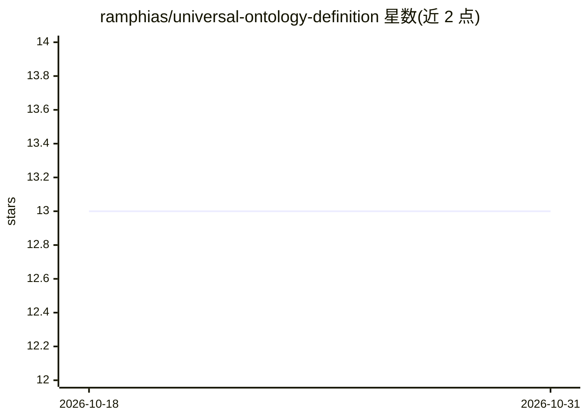

# ramphias/universal-ontology-definition

⭐ 13 · TypeScript · Apache-2.0 · 推送 2026-09-23 · [GitHub](https://github.com/ramphias/universal-ontology-definition) · [官网](https://ramphias.github.io/universal-ontology-definition/) · 个人维护 · 中文 README

**开放的四层企业本体框架：统一建模供知识图谱与 AI Agent 知识库复用**

UOD 是一个开放的四层企业本体框架（L0 平台绑定、L1 核心本体、L2 行业扩展、L3 企业定制），以统一 JSON Schema 定义概念，附带生命周期管理与治理规则，并用 Python 脚本做 CI 校验。L1 v2.0 含 24 个类、13 个广义关系，分 4 个抽象语义域；已提供咨询、金融、医疗等 7 个行业扩展，以及 OWL/RDF、JSON-LD、GraphQL、SQL 四种平台绑定。另附 Ontology Studio（Next.js 可视化管理应用，含 GitHub OAuth 角色控制与 Netlify 部署）。面向需要跨系统统一概念建模的企业架构师与知识工程开发者。

## 筛选速览

| 维度 | 判定 | 备注 |
|---|---|---|
| AI 角色 | `ai-ecosystem` | LLM/agent 周边工具 |
| 许可风险 | `permissive` | Apache-2.0 |
| 部署形态 | `library` | 以包/库形式分发 |
| 模型依赖 | — | README 未给出锁定关系 |
| 硬件要求 | — | 无带数字的原话,不猜 |
| 安装摩擦 | `low` | 无编译、无系统依赖或容器化 |
| 成熟度 | — | 结构信号不足 |

## 能力要点

- 四层分离架构：稳定语义核心 + 可插拔行业/领域扩展 + 企业自定义 + 多平台绑定
- L1 核心 24 类、13 关系，4 个抽象语义域（Entity/Governance/Operational/Measurement）
- 7 个行业扩展（咨询/金融/餐饮/医疗/奢侈品/制造/科技）与 OWL/RDF、JSON-LD、GraphQL、SQL 绑定
- 治理规则脚本 validate_governance.py 做类数上限、命名等 CI 校验

## 适用场景

- 企业知识图谱或语义层建设时获得统一的概念定义基础
- 为 AI Agent 知识库提供标准化的本体结构
- 按技术栈选择 OWL/RDF、GraphQL 或 SQL 绑定直接落地
- 通过 Ontology Studio 可视化浏览与管理本体层

## 场景标签

`知识图谱` · 领域:知识与检索

## 证据(README 行号)

> L15: Universal Ontology Definition (UOD) is an **open, standardized four-layer enterprise ontology framework** designed 
> L41: - ⚙️ **Platform Bindings** — L0 provides ready-to-use OWL/RDF, JSON-LD, GraphQL, and SQL mappings.

## 星数曲线

2026-10-18 13 → 2026-10-31 13（+0）

---
*卡片 v1 · prompt 1.4 · 生成 2026-10-31 · 置信度 mid · 依据 README sha `f7b13a6022d5` · [字段定义](../../DATASET.md)*
