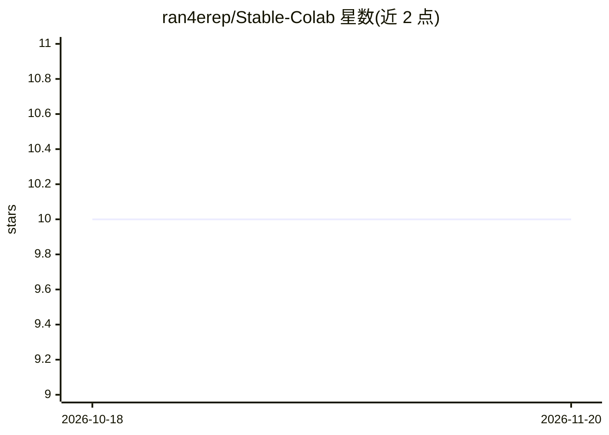

# ran4erep/Stable-Colab

⭐ 10 · Jupyter Notebook · 推送 2026-01-29 · [GitHub](https://github.com/ran4erep/Stable-Colab) · 个人维护

**在 Google Colab 免费 GPU 上运行 Stable Diffusion 生成图像的脚本**

一个 Python/Colab Notebook 脚本（俄英双版本），供用户通过 Google Colaboratory 的免费 T4 GPU 运行 Stable Diffusion 生成图像，无需付费订阅。功能覆盖文生图、image2image、Inpainting、单次多图生成、LoRA 接入、CivitAI 模型加载（仅支持 1.5/2.0，不支持 XL）、CLIP skip、提示词权重、多语言提示词、风格预设、Google Drive 按日期保存与生成前显存清理。使用方式为在 Colab 导入 Notebook 后依次运行代码块；作者建议使用者具备 SD 网页界面使用经验。

## 筛选速览

| 维度 | 判定 | 备注 |
|---|---|---|
| AI 角色 | `ai-native` | 本体是模型或模型工具 |
| 许可风险 | `none` | — |
| 部署形态 | `None` |  |
| 模型依赖 | — | README 未给出锁定关系 |
| 硬件要求 | — | 无带数字的原话,不猜 |
| 安装摩擦 | `medium` | 含编译或系统依赖之一 |
| 成熟度 | — | 结构信号不足 |

## 能力要点

- 支持 txt2img、image2image、Inpainting 三种模式与批量生成
- 可加载 LoRA 与 CivitAI 模型（限 1.5/2.0，不支持 XL）
- 内置用户界面，含风格预设、提示词权重与实时扩散显示
- 图像按日期保存到 Google Drive，每次生成前清理显存

## 适用场景

- 无本地 GPU 时在 Colab 免费运行 Stable Diffusion 生成图像
- 加载 CivitAI 下载的 1.5/2.0 模型与 LoRA 出图
- 生成结果自动按日期归档到 Google Drive

## 场景标签

`图像生成` · 领域:内容生成

## 证据(README 行号)

> L3:  А это мой Python скрипт для того чтобы работать с нейросетью Stable Diffusion через сервис Google Colaboratory без 
> L48:  <dt>1.4.0 - Добавлена поддержка image2image.</dt>

## 星数曲线

2026-10-18 10 → 2026-11-20 10（+0）

---
*卡片 v1 · prompt 1.4 · 生成 2026-11-19 · 置信度 high · 依据 README sha `c18e38298924` · [字段定义](../../DATASET.md)*
