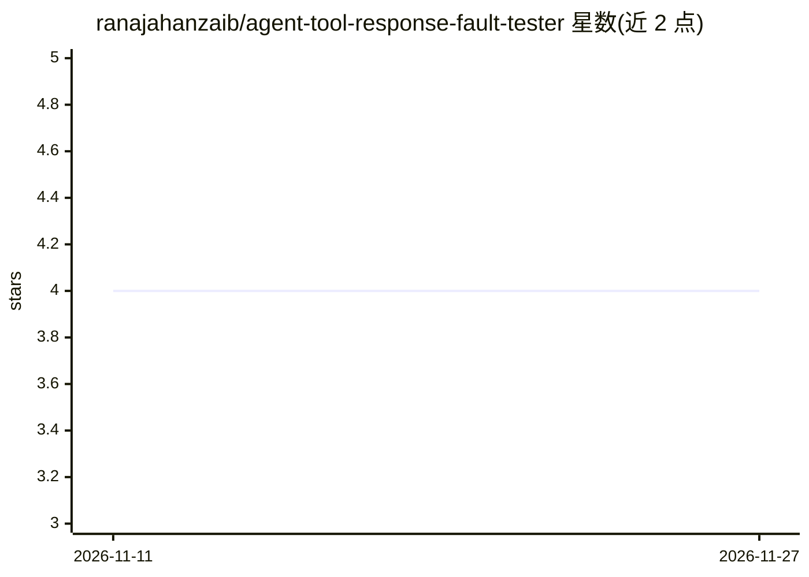

# ranajahanzaib/agent-tool-response-fault-tester

⭐ 4 · Python · MIT · 推送 2026-11-25 · [GitHub](https://github.com/ranajahanzaib/agent-tool-response-fault-tester) · 个人维护

**本地测试 AI agent 在工具响应故障下行为**

本地优先的开发者工具，用于录制 agent 的工具调用流程、注入受控的响应故障并检查 agent 行为证据。支持两种运行模式：scripted（确定性 fixture，不依赖模型下载）与 Ollama 本地推理（真实推理并单独标记）。内置六种故障变换（remove_field、stale_data、truncate 等），输出 JSON 运行记录与可渲染 HTML 报告，并提供 Vite+pnpm 前端仪表盘。需 Python 3.11+、uv、Node.js 22+、pnpm 12。导出时对常见敏感键做脱敏，不自动上传数据。

## 筛选速览

| 维度 | 判定 | 备注 |
|---|---|---|
| AI 角色 | `ai-ecosystem` | LLM/agent 周边工具 |
| 许可风险 | `permissive` | MIT |
| 部署形态 | `library` | 以包/库形式分发 |
| 模型依赖 | local-ok | 支持本地模型 |
| 硬件要求 | — | 无带数字的原话,不猜 |
| 安装摩擦 | `low` | 无编译、无系统依赖或容器化 |
| 成熟度 | — | 结构信号不足 |

## 能力要点

- 注入六种响应故障变换，包含 HTTP 200 业务错误旗舰故障
- scripted 模式确定性可复现，Ollama 模式真实本地推理并分开标记
- record/replay 返回结构化退出码区分通过/失败/不确定
- 本地 API+前端仪表盘，报告可导出为独立 HTML

## 适用场景

- 测试 agent 在工具返回业务错误时是否会误判成功
- 录制基线后重放注入故障做对比实验
- 在本地离线环境评估 agent 工具调用的可靠性

## 场景标签

`模型评测` · 领域:评测与运维

## 证据(README 行号)

> L5: Agent Tool Response Fault Tester is a local-first developer tool for recording tool-using workflows,
> L11: > Scripted results are deterministic fixture evidence, not measured model behavior.
> L83: limits. `--agent scripted` records the cautious strategy; use `scripted-unsafe` to

## 星数曲线

2026-11-11 4 → 2026-11-27 4（+0）

---
*卡片 v1 · prompt 1.4 · 生成 2026-11-21 · 置信度 mid · 依据 README sha `dab3d0fccaa6` · [字段定义](../../DATASET.md)*
