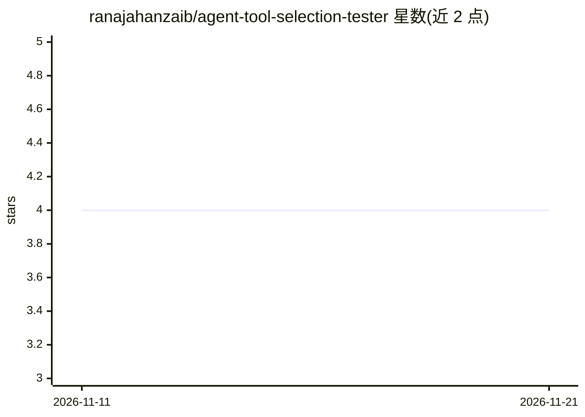

# ranajahanzaib/agent-tool-selection-tester

⭐ 4 · Python · MIT · 推送 2026-11-20 · [GitHub](https://github.com/ranajahanzaib/agent-tool-selection-tester) · 个人维护

**评测本地 LLM 在工具名/描述/顺序变化下的选工具可靠性**

基于 MCP 的行为评测工具：内置六个虚构客户与订单工具，通过 MCP tools/list 与 tools/call 发现并调用，将 schema 桥接到 Ollama 的结构化 tool-calling API。默认套件含 17 个任务、3 次重复、基线与九种界面变体，输出首次选择、schema 合法性、参数正确性、任务完成度、越权写入与混淆计数等指标，结果存入 SQLite 并提供 CLI 与 Streamlit 仪表盘。面向使用 MCP 与本地模型做工具调用评测的开发者。

## 筛选速览

| 维度 | 判定 | 备注 |
|---|---|---|
| AI 角色 | `ai-ecosystem` | LLM/agent 周边工具 |
| 许可风险 | `permissive` | MIT |
| 部署形态 | `None` |  |
| 模型依赖 | local-ok | 支持本地模型 |
| 硬件要求 | — | 无带数字的原话,不猜 |
| 安装摩擦 | `low` | 无编译、无系统依赖或容器化 |
| 成熟度 | — | 结构信号不足 |

## 能力要点

- 六类确定性工具评测指标，含混淆矩阵与越权写入检测
- 单维度、带种子的界面变体（改写/缩短/别名/排序等）
- SQLite 追加式存储与 JSON/CSV 导出，Streamlit/Plotly 仪表盘
- 离线脚本适配器支持不接 Ollama 的自动化检查

## 适用场景

- 评估本地模型在工具名或描述变化下选工具的稳定性
- 为 MCP 服务器工具做契约测试的行为补充验证
- 对比不同模型或参数下的 tool-calling 表现记录

## 场景标签

`模型评测` · 领域:评测与运维

## 证据(README 行号)

> L5: Agent Tool Selection Tester measures how a local language model selects and uses related tools when the exposed name
> L73: `core.py` defines Pydantic models, deterministic fixture handlers, variants, tasks, and evaluator rules. `mcp_runti

## 星数曲线

2026-11-11 4 → 2026-11-21 4（+0）

---
*卡片 v1 · prompt 1.4 · 生成 2026-11-21 · 置信度 high · 依据 README sha `9482b9acb1b3` · [字段定义](../../DATASET.md)*
