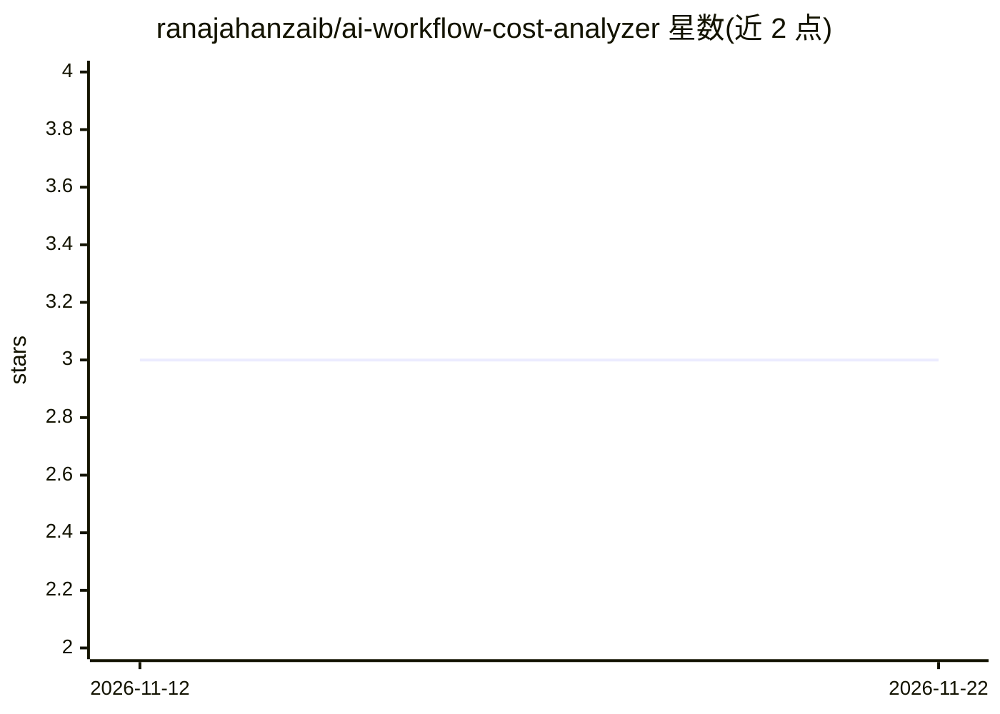

# ranajahanzaib/ai-workflow-cost-analyzer

⭐ 3 · Python · MIT · 推送 2026-11-21 · [GitHub](https://github.com/ranajahanzaib/ai-workflow-cost-analyzer) · 个人维护

**本地成本分析层：测算 AI 工作流每次验证成功的真实成本**

一个独立运行的本地经济学分析工具：读取模型/工具调用费用、重试、人工审核与回退工作量、业务结果证据及纯人工基线数据，计算每次验证成功的成本、成功率与节省额。后端为 FastAPI，数据存于 DuckDB，支持 JSON/JSONL/CSV 及 OTLP trace 导入，带仪表盘界面。定位为本地工具，无认证，仅限受信任环境使用；仅支持 USD 计价。

## 筛选速览

| 维度 | 判定 | 备注 |
|---|---|---|
| AI 角色 | `ai-ecosystem` | LLM/agent 周边工具 |
| 许可风险 | `permissive` | MIT |
| 部署形态 | `None` |  |
| 模型依赖 | — | README 未给出锁定关系 |
| 硬件要求 | — | 无带数字的原话,不猜 |
| 安装摩擦 | `low` | 无编译、无系统依赖或容器化 |
| 成熟度 | — | 结构信号不足 |

## 能力要点

- 以验证成功的业务结果（而非模型响应）为单位核算成本
- Decimal 精确计算推理与人工成本，含重试与人工回退工作量
- DuckDB 本地持久化，支持 JSON/JSONL/CSV 与 OTLP/JSON 导入及幂等校验
- 提供 FastAPI API、OpenAPI 文档与响应式仪表盘

## 适用场景

- 核算 AI 工作流包含重试和人工审核在内的真实单位成本
- 对比高低精度两种模型配置的成本效益
- 通过场景分析评估不同假设下的成本变化
- 用人工基线计算自动化替代带来的节省额

## 场景标签

`LLM 可观测性` · 领域:评测与运维

## 证据(README 行号)

> L5: Inference spend alone does not describe the economics of an AI workflow. AI Workflow Cost Analyzer combines model an
> L7: AI Workflow Cost Analyzer is an independent local economics analysis layer. It is not a chat app, framework wrapper,
> L79: FastAPI delivers the API, DuckDB stores normalized data, and core calculations live outside route handlers. The app

## 星数曲线

2026-11-12 3 → 2026-11-22 3（+0）

---
*卡片 v1 · prompt 1.4 · 生成 2026-11-21 · 置信度 high · 依据 README sha `d6ce3b3fe6da` · [字段定义](../../DATASET.md)*
