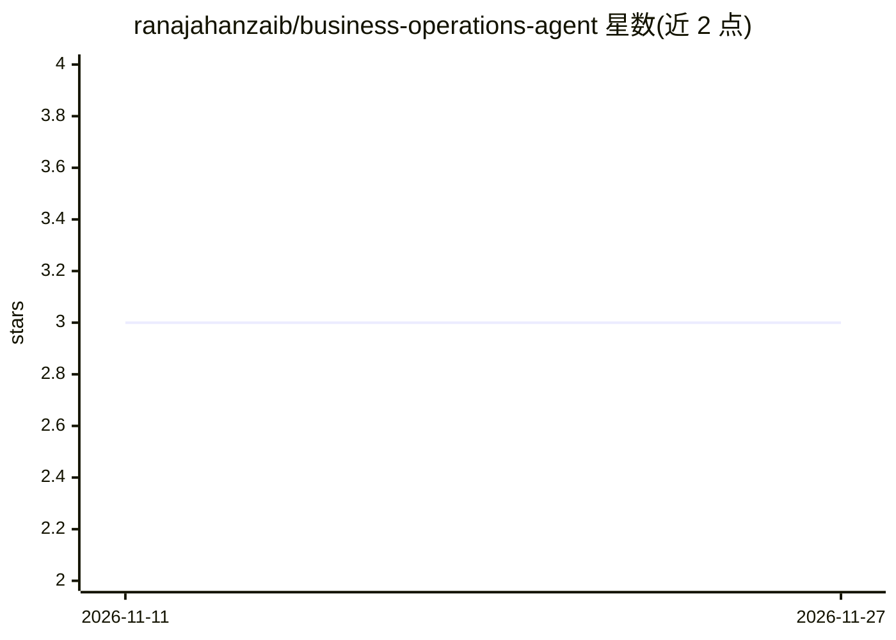

# ranajahanzaib/business-operations-agent

⭐ 3 · Python · MIT · 推送 2026-11-25 · [GitHub](https://github.com/ranajahanzaib/business-operations-agent) · 个人维护

**本地运行的 AI 业务操作参考系统：模型提案+人工审批**

面向合成零售业务数据的本地优先参考实现：配置的模型通过类型化只读工具查询业务数据，生成提案后暂停等待人工审批，审批通过的变更原子写入 SQLite，并由独立验证步骤核对落库结果。基于 LangGraph 工作流与 SQLite 检查点，内置幂等记录、执行账本、事件历史与本地操作员/审计员角色。作者明确说明这是参考实现，非生产级多租户服务，仅建议在 localhost 使用。

## 筛选速览

| 维度 | 判定 | 备注 |
|---|---|---|
| AI 角色 | `ai-ecosystem` | LLM/agent 周边工具 |
| 许可风险 | `permissive` | MIT |
| 部署形态 | `library` | 以包/库形式分发 |
| 模型依赖 | local-ok | 支持本地模型 |
| 硬件要求 | — | 无带数字的原话,不猜 |
| 安装摩擦 | `low` | 无编译、无系统依赖或容器化 |
| 成熟度 | — | 结构信号不足 |

## 能力要点

- LangGraph 工作流 + SQLite 检查点与审批中断
- 人工审批绑定提案哈希、操作员角色与业务状态
- 执行账本与幂等键防止重复副作用
- 独立验证核对已提交的工单行而非模型输出文本

## 适用场景

- 学习带人工审批环节的 agentic 工作流参考模式
- 在本地演示模型提案→审批→落库→验证的闭环
- 参考其工具注册与只读/提案分类的工具契约设计

## 场景标签

`工作流自动化` · 领域:效率与自动化

## 证据(README 行号)

> L3: OpsAgent is a local-first AI business operations reference system. It gives a configured model provider typed read t
> L5: The project demonstrates a bounded workflow with durable checkpoints, explicit permissions, immutable proposal paylo
> L11: - LangGraph workflow with SQLite checkpointing and an approval interrupt.

## 星数曲线

2026-11-11 3 → 2026-11-27 3（+0）

---
*卡片 v1 · prompt 1.4 · 生成 2026-11-21 · 置信度 low · 依据 README sha `14d498e8169c` · [字段定义](../../DATASET.md)*
