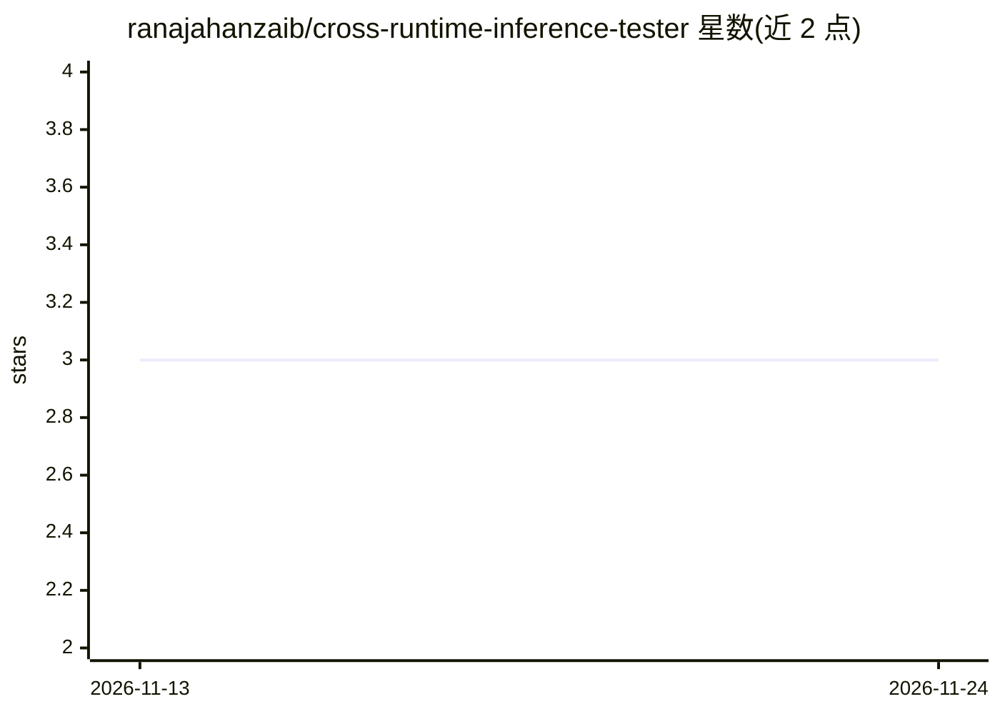

# ranajahanzaib/cross-runtime-inference-tester

⭐ 3 · TypeScript · MIT · 推送 2026-11-23 · [GitHub](https://github.com/ranajahanzaib/cross-runtime-inference-tester) · 个人维护

**面向 ML 工程师的 ONNX 跨运行时推理一致性验证工具**

验证同一个 ONNX 模型在 Python ONNX Runtime 与浏览器 ONNX Runtime Web 之间是否产生等价输出：用确定性 scikit-learn 流程训练并导出 float32 ONNX 工件，校验 SHA-256 与图元数据，生成 268 条测试向量在浏览器 WASM 环境执行，按数值容差比较输出并报告类别一致率与各阶段延迟，产出 JSON/HTML/Markdown 报告与静态仪表盘。通过 uv/pnpm CLI 使用，浏览器端无服务端推理端点、无需 GPU 或账号。当前浏览器 UI 仅支持内置合成二分类器及 float32 数值输入契约，WebGPU 与多线程 WASM 不在验证范围内。

## 筛选速览

| 维度 | 判定 | 备注 |
|---|---|---|
| AI 角色 | `ai-ecosystem` | LLM/agent 周边工具 |
| 许可风险 | `permissive` | MIT |
| 部署形态 | `library` | 以包/库形式分发 |
| 模型依赖 | — | README 未给出锁定关系 |
| 硬件要求 | — | 无带数字的原话,不猜 |
| 安装摩擦 | `low` | 无编译、无系统依赖或容器化 |
| 成熟度 | — | 结构信号不足 |

## 能力要点

- Python 与浏览器 ONNX Runtime 的数值漂移与类别一致率对比
- SHA-256 工件校验与清单（图元数据/opset/版本）契约检查
- CLI 基准测试输出初始化/首次推理/热延迟等分批测量
- 静态仪表盘含实时浏览器推理、容差重算与故障注入

## 适用场景

- 模型从 Python 部署到浏览器 WASM 前核验输出一致性
- 排查跨运行时推理的数值漂移与形状/非有限值错误
- 测量浏览器端推理的初始化与各批次大小延迟

## 场景标签

`模型评测` · 领域:评测与运维

## 证据(README 行号)

> L5: Cross-Runtime Inference Tester measures whether a numerical ONNX model produces equivalent outputs in Python ONNX Ru
> L66: `cross-runtime-inference-tester verify` writes `report.json`, `report.html`, and `report.md` in `artifacts/reports/

## 星数曲线

2026-11-13 3 → 2026-11-24 3（+0）

---
*卡片 v1 · prompt 1.4 · 生成 2026-11-21 · 置信度 mid · 依据 README sha `258f416e3b8d` · [字段定义](../../DATASET.md)*
