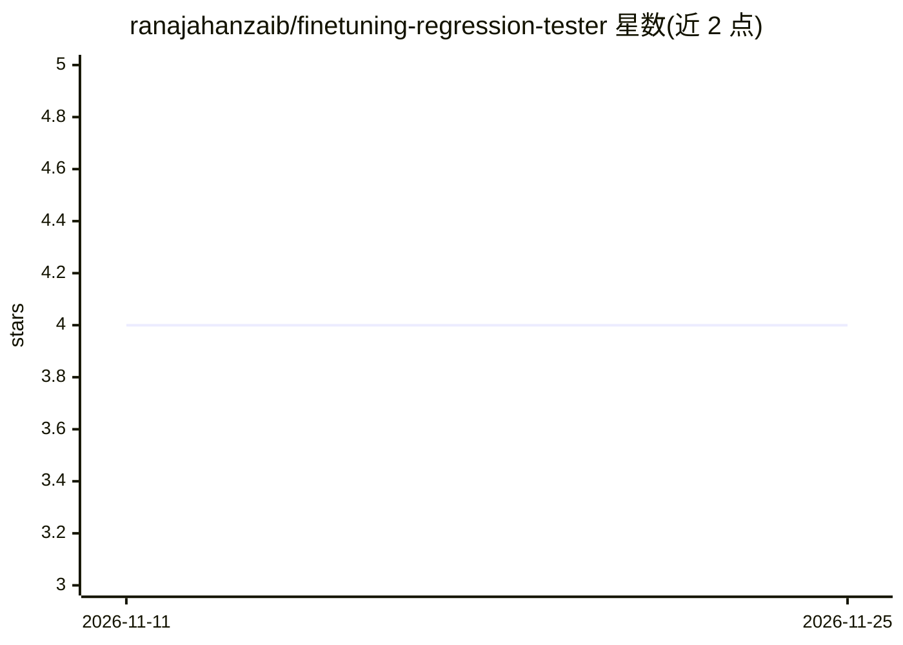

# ranajahanzaib/finetuning-regression-tester

⭐ 4 · Python · MIT · 推送 2026-11-23 · [GitHub](https://github.com/ranajahanzaib/finetuning-regression-tester) · 个人维护

**微调前后对比评估工具：量化任务收益与行为回退**

围绕 MLX-LM 的独立评估层，对同一批保留集上微调前后的本地模型做配对比较：生成确定性合成数据与各类探测用例，用确定性评分器检查 JSON 严格性、字段正确性、指令遵循、弃答等维度，输出保留成功/回退/改进等分类与逐用例明细，导出 JSON/CSV/Markdown/离线 HTML 及可选 Streamlit 仪表盘。离线分析跨平台可用；真实推理与训练需 Apple Silicon 上的 macOS 与 MLX-LM。模型权重不含在仓库内，需显式下载。

## 筛选速览

| 维度 | 判定 | 备注 |
|---|---|---|
| AI 角色 | `ai-ecosystem` | LLM/agent 周边工具 |
| 许可风险 | `permissive` | MIT |
| 部署形态 | `None` |  |
| 模型依赖 | — | README 未给出锁定关系 |
| 硬件要求 | — | 无带数字的原话,不猜 |
| 安装摩擦 | `low` | 无编译、无系统依赖或容器化 |
| 成熟度 | — | 结构信号不足 |

## 能力要点

- 配对比较输出 preserved/regression/improvement 分类与逐用例明细
- 确定性合成数据生成与确定性评分器，无需外部服务
- 导出 JSON/JSONL/CSV/Markdown/离线 HTML，可选本地 Streamlit/Plotly 仪表盘
- 中断评估按用例 ID 保留已完成结果并续跑

## 适用场景

- 微调后检查模型是否在目标任务之外出现行为回退
- 在 Apple Silicon 本地跑基线→训练→评估→报告的完整实验
- 为模型评估结果生成可分享的离线 HTML 报告

## 场景标签

`模型评测` `微调` · 领域:评测与运维

## 证据(README 行号)

> L5: FineTuning Regression Tester compares a local language model before and after fine-tuning on the same held-out examp
> L13: - Integrates optional MLX-LM base and LoRA adapter inference and bounded training on Apple Silicon.

## 星数曲线

2026-11-11 4 → 2026-11-25 4（+0）

---
*卡片 v1 · prompt 1.4 · 生成 2026-11-21 · 置信度 high · 依据 README sha `f08a6e5df303` · [字段定义](../../DATASET.md)*
