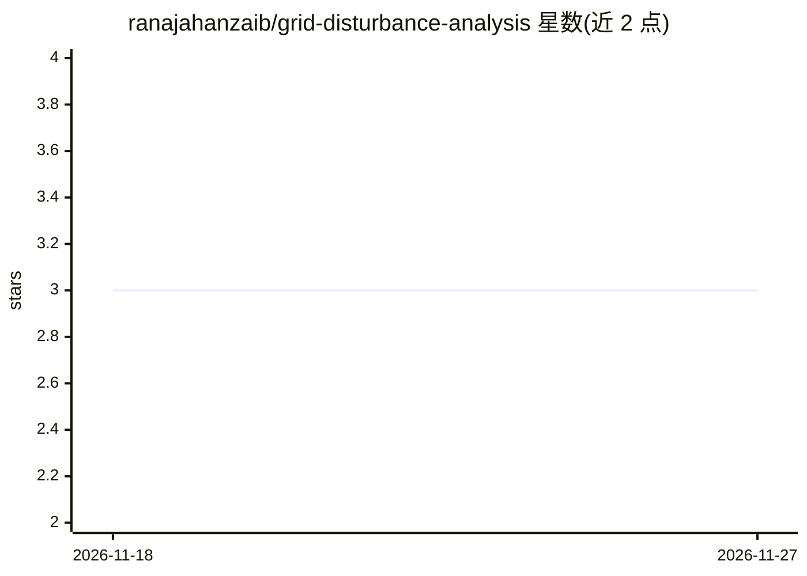

# ranajahanzaib/grid-disturbance-analysis

⭐ 3 · Python · MIT · 推送 2026-11-23 · [GitHub](https://github.com/ranajahanzaib/grid-disturbance-analysis) · 个人维护

**面向电网工程师的 PMU 振荡扰动分析与溯源引擎**

以信号处理与机器学习方法分析同步相量 PMU 数据，识别并区分强迫振荡、自然振铃、弱阻尼区域间模式与频率失稳等扰动类型。内置 FFT/Welch PSD/小波分解/Hilbert 变换/Matrix Pencil 等算法，34 维特征向量输入随机森林、SVM、时间卷积与频谱 CNN 等模型进行分类。提供 Typer CLI、Streamlit 诊断面板、SQLite 持久化与 HTML/JSON 报告导出，并集成 DOE/ORNL 的 GESL 事件签名数据集。单通道数据不提供方向定位，需至少 2 个同步通道。

## 筛选速览

| 维度 | 判定 | 备注 |
|---|---|---|
| AI 角色 | `ai-native` | 本体是模型或模型工具 |
| 许可风险 | `permissive` | MIT |
| 部署形态 | `None` |  |
| 模型依赖 | — | README 未给出锁定关系 |
| 硬件要求 | — | 无带数字的原话,不猜 |
| 安装摩擦 | `low` | 无编译、无系统依赖或容器化 |
| 成熟度 | — | 结构信号不足 |

## 能力要点

- 强迫振荡与自然振铃的假设判别，证据不足时可输出 indeterminate
- Matrix Pencil/Prony 模态参数估计与阻尼比（ζ）分类
- 多通道互谱相干性与相位超前做扰动源上游定位
- 内置 12 种物理场景的确定性合成信号生成器

## 适用场景

- 分析 PMU 录波数据判别振荡是强迫振荡还是自然振铃
- 对弱阻尼区域间低频振荡做模态与阻尼比估计
- 利用多通道相干性评估强迫振荡源的上游位置
- 批量处理扰动事件并导出诊断报告

## 场景标签

`数据分析` · 领域:效率与自动化

## 证据(README 行号)

> L27: `grid-disturbance-analysis` provides a rigorous signal-processing, machine learning, and diagnostic framework to an
> L40:  - **Forced Oscillation Detection:** Spectral concentration, sliding-window persistence, frequency stability, envel
> L48:  - Classical ensembles: Random Forest, Extra Trees, Gradient Boosted Trees, Logistic Regression, SVM.

## 星数曲线

2026-11-18 3 → 2026-11-27 3（+0）

---
*卡片 v1 · prompt 1.4 · 生成 2026-11-21 · 置信度 high · 依据 README sha `cb1ba1900edc` · [字段定义](../../DATASET.md)*
