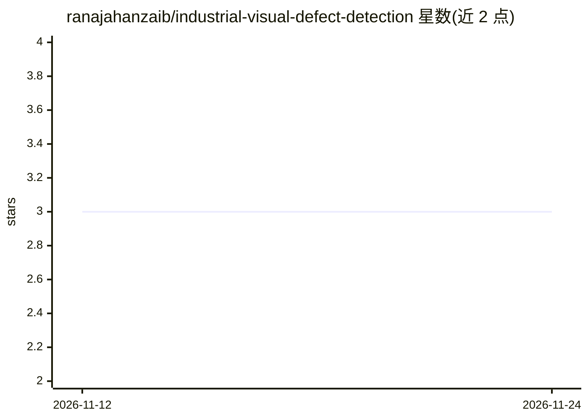

# ranajahanzaib/industrial-visual-defect-detection

⭐ 3 · Python · MIT · 推送 2026-11-23 · [GitHub](https://github.com/ranajahanzaib/industrial-visual-defect-detection) · 个人维护

**面向工业 QA/QC 的无监督视觉缺陷检测工作台**

开源研究型工作台，用正常产品图像训练视觉异常检测器，包含 PyTorch teacher–student 特征蒸馏检测器、ResNet18 最近邻特征库基线、VisA 数据集适配器、normal-only 阈值校准、AUROC/平均精度等评估指标、FastAPI 推理服务与 React 检查工作台。以 Python 包安装，需 Python 3.11+；仓库不含 VisA 数据、训练权重或基准结果，数据集需从官方渠道获取，异常分数非概率。

## 筛选速览

| 维度 | 判定 | 备注 |
|---|---|---|
| AI 角色 | `ai-native` | 本体是模型或模型工具 |
| 许可风险 | `permissive` | MIT |
| 部署形态 | `library` | 以包/库形式分发 |
| 模型依赖 | — | README 未给出锁定关系 |
| 硬件要求 | — | 无带数字的原话,不猜 |
| 安装摩擦 | `low` | 无编译、无系统依赖或容器化 |
| 成熟度 | `idea` | |

## 能力要点

- PyTorch teacher–student 特征蒸馏检测器与 PatchCore 风格基线两条检测路径
- normal-only 阈值校准协议与 AUROC/平均精度等评估指标
- FastAPI 服务 + React 检查工作板，支持图像上传与热力图
- 支持 VisA 全部 12 个 one-class 类别适配

## 适用场景

- 用正常样本图像训练工业产品表面缺陷检测模型
- 在本地对比多个检测器运行的指标与视觉误差
- 搭建质检图像上传与异常区域检查的 API 和前端

## 场景标签

`图像视频处理` · 领域:感知与多模态

## 证据(README 行号)

> L3: **Train visual anomaly detectors using normal product images. Inspect unusual regions, evaluate failures, and compar
> L5: Industrial Visual Defect Detection is an open-source research workbench for industrial visual inspection. It include

## 星数曲线

2026-11-12 3 → 2026-11-24 3（+0）

---
*卡片 v1 · prompt 1.4 · 生成 2026-11-21 · 置信度 mid · 依据 README sha `b0c813a011d5` · [字段定义](../../DATASET.md)*
