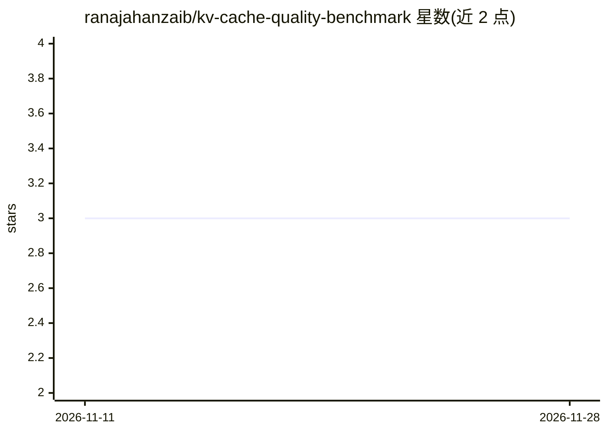

# ranajahanzaib/kv-cache-quality-benchmark

⭐ 3 · Python · MIT · 推送 2026-11-25 · [GitHub](https://github.com/ranajahanzaib/kv-cache-quality-benchmark) · 个人维护

**本地评测 llama.cpp KV-cache 压缩质量与内存开销的工具**

本地运行的基准测试工具与仪表盘：对同一 GGUF 模型在 F16/Q8/Q4/混合 KV 缓存配置下发送相同序列化提示，记录答案正确性、长上下文事实保持率、llama.cpp 计时元数据与进程 RSS，并按 F16 基线做配对回归/提升分析。工具内置针检索、干扰抗性、不可答提示等 fixture 套件，提供 CLI 与 FastAPI 本地仪表盘，结果落盘 SQLite/JSONL。需用户提供 llama-server 与 GGUF 模型，不下载模型、不调用云服务；macOS Apple Silicon 为主要目标平台。

## 筛选速览

| 维度 | 判定 | 备注 |
|---|---|---|
| AI 角色 | `ai-ecosystem` | LLM/agent 周边工具 |
| 许可风险 | `permissive` | MIT |
| 部署形态 | `library` | 以包/库形式分发 |
| 模型依赖 | local-ok | 支持本地模型 |
| 硬件要求 | — | 无带数字的原话,不猜 |
| 安装摩擦 | `high` | 编译与系统依赖俱全 |
| 成熟度 | — | 结构信号不足 |

## 能力要点

- F16/Q8/Q4/混合 KV 缓存配置的同提示配对对比与回归分析
- 针检索、事实保持、干扰抗性、不可答提示四类 fixture 测试
- CLI 导出 JSON/CSV/Markdown，本地交互式仪表盘
- 不下载模型、不调用云服务，结果本地落盘 SQLite/JSONL

## 适用场景

- 量化 KV cache 前后对比模型长上下文回答质量
- 为本地 llama.cpp 部署选择显存/内存占用与质量的缓存配置
- 生成可复现的基准报告用于模型配置决策

## 场景标签

`模型评测` `模型量化` · 领域:评测与运维

## 证据(README 行号)

> L5: A local, reproducible test harness for comparing answer correctness, long-context fact retention, and memory use acr
> L25: The benchmark provides both an interactive local dashboard and a scriptable CLI with export capabilities.
> L41: No CUDA, Docker, hosted service, or bundled model weights are required. The selected llama.cpp build determines the

## 星数曲线

2026-11-11 3 → 2026-11-28 3（+0）

---
*卡片 v1 · prompt 1.4 · 生成 2026-11-21 · 置信度 mid · 依据 README sha `48adcc93833d` · [字段定义](../../DATASET.md)*
