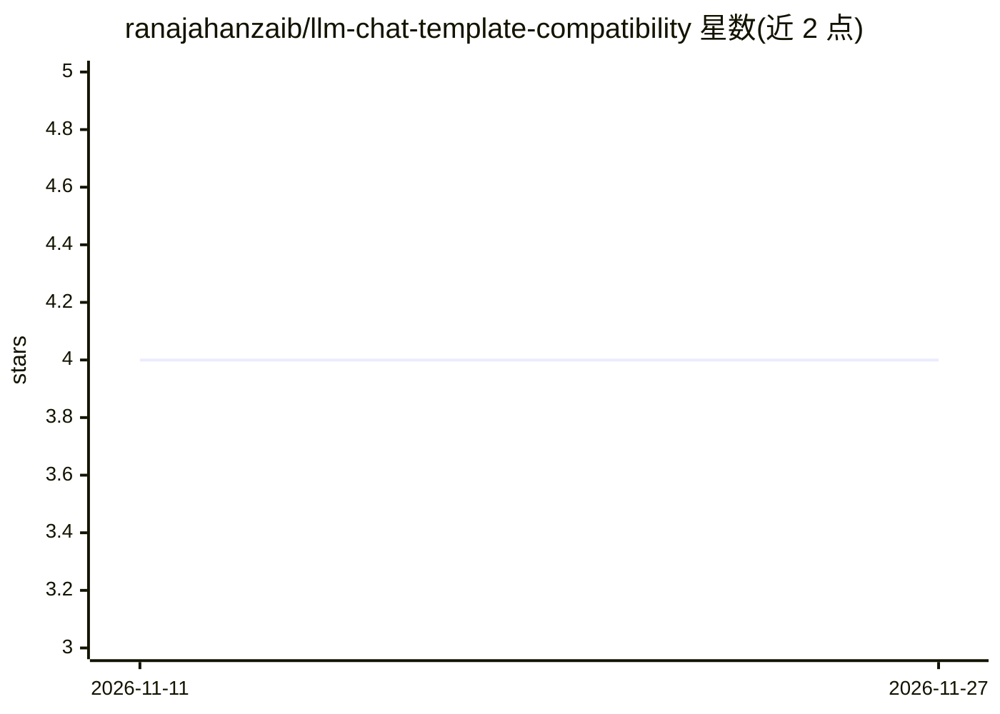

# ranajahanzaib/llm-chat-template-compatibility

⭐ 4 · Python · MIT · 推送 2026-11-25 · [GitHub](https://github.com/ranajahanzaib/llm-chat-template-compatibility) · 个人维护

**比较 MLX-LM 与 llama.cpp 渲染与分词差异的调试工具**

面向本地 LLM 推理运行时的差异排查工具：将对话的渲染、分词、生成三个阶段分离，通过 llama.cpp 服务器的 apply-template/tokenize/completion API 与 MLX-LM 的 tokenizer 模板路径捕获 token ID，进行序列比对并输出首个分歧点、BOS/前缀/停止符差异等确定性结论，生成 JSON 工件与 Markdown 报告及本地 React 检查器。需 Python 3.11+ 与 uv，Apple Silicon 上可选安装 MLX-LM；模型下载与转换为显式操作，不自动下载。

## 筛选速览

| 维度 | 判定 | 备注 |
|---|---|---|
| AI 角色 | `ai-ecosystem` | LLM/agent 周边工具 |
| 许可风险 | `permissive` | MIT |
| 部署形态 | `library` | 以包/库形式分发 |
| 模型依赖 | local-ok | 支持本地模型 |
| 硬件要求 | — | 无带数字的原话,不猜 |
| 安装摩擦 | `low` | 无编译、无系统依赖或容器化 |
| 成熟度 | — | 结构信号不足 |

## 能力要点

- 分离渲染/分词/生成的受控比较路径，提交数字 token ID 避免二次分词
- 8 个内置对话夹具（多轮、assistant-prefill、tool-result、Unicode）
- 序列比对输出 insert/delete/replace 跨度与首个分歧点
- 版本化 JSON 工件 + Markdown 报告 + 本地 Web 检查器

## 适用场景

- 同一对话在不同本地运行时输出不一致时定位提示与 token 差异
- 排查 chat 模板渲染与 BOS/停止符处理差异
- 对模板修改做可复现的捕获与回归比较

## 场景标签

 · 领域:LLM 推理基础设施/调试工具

## 证据(README 行号)

> L5: LLM Chat Template Compatibility is a focused tool for reproducing and investigating inference prompt-path discrepanc
> L127: ## Supported runtime matrix
> L129: |Runtime|Prompt rendering|Tokenization|Controlled generation|Requirements|

## 星数曲线

2026-11-11 4 → 2026-11-27 4（+0）

---
*卡片 v1 · prompt 1.4 · 生成 2026-11-21 · 置信度 mid · 依据 README sha `532a08bed66c` · [字段定义](../../DATASET.md)*
