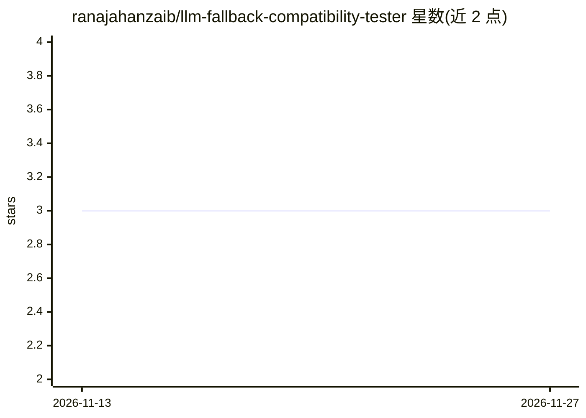

# ranajahanzaib/llm-fallback-compatibility-tester

⭐ 3 · Rust · MIT · 推送 2026-11-25 · [GitHub](https://github.com/ranajahanzaib/llm-fallback-compatibility-tester) · 个人维护

**给 LLM 应用开发者测试模型故障切换是否保持行为与安全**

Rust 编写的 CI 合同测试工具：以 YAML/JSON 声明 provider 候选、测试用例、断言与故障注入，向 provider 注入失败，评估实际处理请求的回退响应是否满足合同，输出 JSON/JUnit/本地 HTML 报告。支持 JSON Schema 校验、字段与包含关系、正则、tool-call 参数检查等断言；mock provider 无需网络与 API key。不做生产流量路由，不执行业务工具，能力需用户声明而不自动推断。

## 筛选速览

| 维度 | 判定 | 备注 |
|---|---|---|
| AI 角色 | `ai-ecosystem` | LLM/agent 周边工具 |
| 许可风险 | `permissive` | MIT |
| 部署形态 | `library` | 以包/库形式分发 |
| 模型依赖 | local-ok | 支持本地模型 |
| 硬件要求 | — | 无带数字的原话,不猜 |
| 安装摩擦 | `low` | 无编译、无系统依赖或容器化 |
| 成熟度 | — | 结构信号不足 |

## 能力要点

- 声明式合同（YAML/JSON，v1 schema 校验）定义回退测试与故障注入
- mock provider 本地确定性运行，无需 API key、模型或网络
- 输出 run.json/summary.json/junit.xml 与离线可用的 HTML 报告
- 默认脱敏 prompt 与响应内容，凭据仅从环境变量读取

## 适用场景

- 在 CI 中验证 LLM provider 回退切换后应用行为不破坏
- 为网关/路由的 fallback 策略编写可复现的兼容性合同测试
- 本地离线开发阶段用 mock 场景演练回退失败注入

## 场景标签

`模型评测` · 领域:评测与运维

## 证据(README 行号)

> L8: A fallback can return HTTP 200 and valid JSON while violating a business rule. LLM Fallback Compatibility Tester run
> L43: ## Providers
> L91: Production gateways route requests and apply operational fallback policies. LLM Fallback Compatibility Tester tests

## 星数曲线

2026-11-13 3 → 2026-11-27 3（+0）

---
*卡片 v1 · prompt 1.4 · 生成 2026-11-21 · 置信度 mid · 依据 README sha `46a813efe6ca` · [字段定义](../../DATASET.md)*
