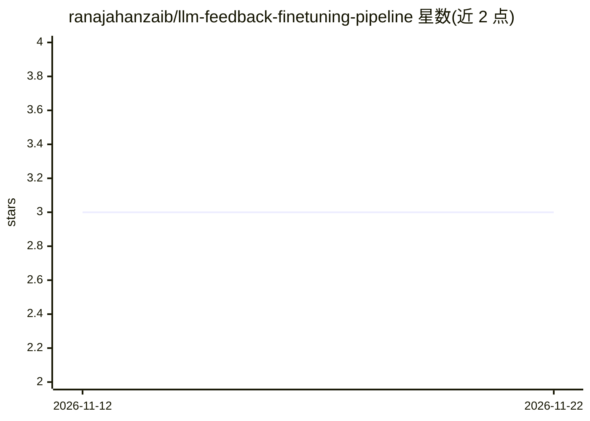

# ranajahanzaib/llm-feedback-finetuning-pipeline

⭐ 3 · Python · MIT · 推送 2026-11-21 · [GitHub](https://github.com/ranajahanzaib/llm-feedback-finetuning-pipeline) · 个人维护

**把业务反馈修正转为 Apple Silicon 本地 LoRA 微调模型的工作流**

本地优先的反馈微调流水线：导入人工修正，经审核、冲突隔离与脱敏检查后构建带 SHA-256 哈希的不可变数据集快照，用 MLX-LM 运行 LoRA 训练，在冻结测试集上做配对评估，晋升须满足评估证据、至少 30 条样本和 98% schema 达标。提供 FastAPI 本地服务、React 操作台与确定性合成演示模式；真实训练与推理需 Apple Silicon 硬件与模型权重。

## 筛选速览

| 维度 | 判定 | 备注 |
|---|---|---|
| AI 角色 | `ai-ecosystem` | LLM/agent 周边工具 |
| 许可风险 | `permissive` | MIT |
| 部署形态 | `library` | 以包/库形式分发 |
| 模型依赖 | — | README 未给出锁定关系 |
| 硬件要求 | — | 无带数字的原话,不猜 |
| 安装摩擦 | `low` | 无编译、无系统依赖或容器化 |
| 成熟度 | `idea` | |

## 能力要点

- 不可变数据集版本快照与 manifest 哈希校验
- MLX-LM LoRA 训练与冻结测试集配对评估（含 bootstrap 区间）
- 晋升门控：评估证据 + 30 条样本 + 98% schema 达标
- 冲突隔离、敏感信息标记与删除审计的反馈审核流程

## 适用场景

- 把客服/运营修正持续转化为本地专用模型
- 在 Apple Silicon 上离线微调并做回归门控部署
- 需要可追溯数据集版本与审计记录的团队微调流程

## 场景标签

`微调` `模型评测` · 领域:评测与运维

## 证据(README 行号)

> L7: LLM Feedback Fine-Tuning Pipeline provides a persistent feedback workflow, immutable dataset snapshots, a localhost 
> L20: `llm_feedback_finetuning_pipeline.tasks.TaskSpec` defines the task contract: identifiers and prompt version, a Pyda
> L107: Supported presets are `smoke`, `standard`, and `extended`. Smoke is an operational check, not a training-quality c

## 星数曲线

2026-11-12 3 → 2026-11-22 3（+0）

---
*卡片 v1 · prompt 1.4 · 生成 2026-11-21 · 置信度 mid · 依据 README sha `a10e7d6d3e2f` · [字段定义](../../DATASET.md)*
