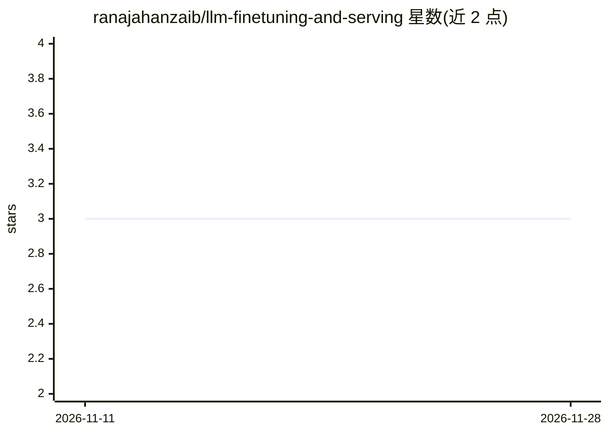

# ranajahanzaib/llm-finetuning-and-serving

⭐ 3 · Python · MIT · 推送 2026-11-25 · [GitHub](https://github.com/ranajahanzaib/llm-finetuning-and-serving) · 个人维护

**Apple Silicon 上的 LLM 微调、评估与本地服务化工作台**

面向银行客服意图分类任务的本地机器学习工作台，覆盖数据准备（BANKING77 数据集下载与分层切分）、MLX-LM LoRA 训练、零样本/few-shot/适配后评估（准确率、F1、混淆计数、延迟吞吐）与 FastAPI 服务化，附带 React/TypeScript Web 控制台。通过 uv 管理依赖，提供 CLI 命令与回归测试集成（finetuning-regression-tester）。限制：真实训练与推理需 macOS + Apple Silicon；本版本未包含已训练适配器或性能结果，仅提供合成示例。MIT 许可。

## 筛选速览

| 维度 | 判定 | 备注 |
|---|---|---|
| AI 角色 | `ai-ecosystem` | LLM/agent 周边工具 |
| 许可风险 | `permissive` | MIT |
| 部署形态 | `library` | 以包/库形式分发 |
| 模型依赖 | — | README 未给出锁定关系 |
| 硬件要求 | — | 无带数字的原话,不猜 |
| 安装摩擦 | `low` | 无编译、无系统依赖或容器化 |
| 成熟度 | `idea` | |

## 能力要点

- BANKING77 数据集准备、MLX-LM LoRA 训练与多模式评估的完整本地流水线
- 评估输出准确率、宏/加权 F1、混淆计数、延迟与逐例输出
- FastAPI 服务与 React Web 控制台，默认仅绑定 loopback
- 集成 finetuning-regression-tester 做基线→适配后对比与回归报告

## 适用场景

- 在 Apple Silicon 上微调并评估银行客服意图分类模型
- 本地运行推理 API 与 Playground 查看预测结果
- 对微调实验做基线对比与回归测试

## 场景标签

`微调` `模型评测` `推理引擎` · 领域:评测与运维

## 证据(README 行号)

> L3: LLM Fine-tuning and Serving is a local machine-learning workbench for adapting and evaluating a language model on ba
> L46: Set `LLM_FINETUNING_AND_SERVING_ADAPTER` to a trained adapter directory for adapted inference. Training invokes MLX
> L67: uv run llm-finetuning-and-serving serve                 # localhost:8000

## 星数曲线

2026-11-11 3 → 2026-11-28 3（+0）

---
*卡片 v1 · prompt 1.4 · 生成 2026-11-21 · 置信度 mid · 依据 README sha `bab3bb58ebc2` · [字段定义](../../DATASET.md)*
