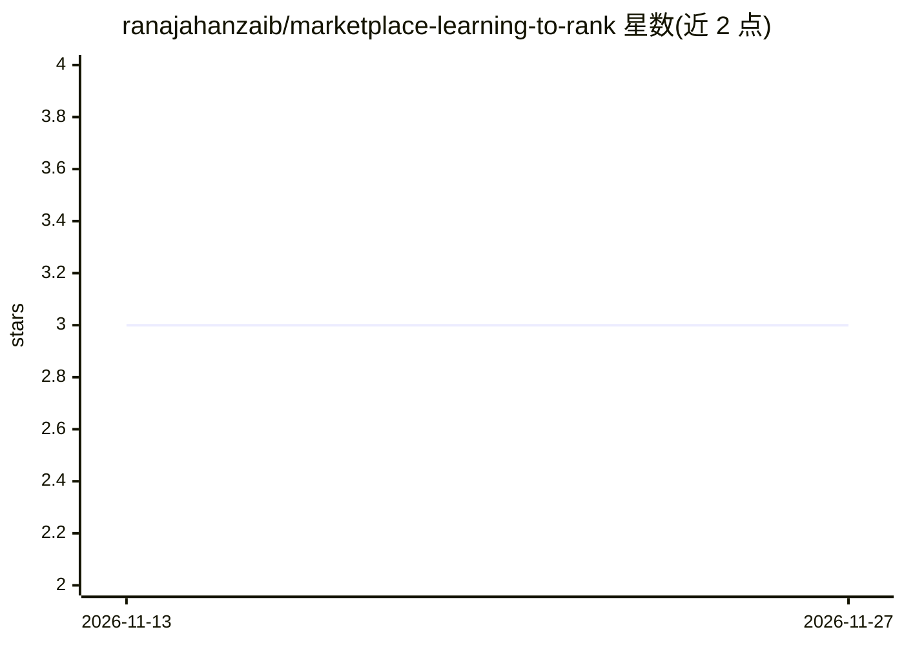

# ranajahanzaib/marketplace-learning-to-rank

⭐ 3 · Python · MIT · 推送 2026-11-25 · [GitHub](https://github.com/ranajahanzaib/marketplace-learning-to-rank) · 个人维护

**本地排序学习实验场：比较规则、语义与LambdaMART排序**

面向专业服务双边市场的本地学习排序实验环境：先用市场资格规则过滤候选，再结合 TF-IDF 词法检索与本地缓存 Sentence Transformers 密集检索，在同一候选池上比较规则基线、语义基线与 LightGBM LambdaMART 三种排序策略。提供合成数据生成、NDCG/Recall/MRR 等评估、FastAPI 接口、SQLite 实验事件存储与 React 工作台。限制：全部数据为合成，无真实业务提升证据，仅限本地运行。

## 筛选速览

| 维度 | 判定 | 备注 |
|---|---|---|
| AI 角色 | `ai-native` | 本体是模型或模型工具 |
| 许可风险 | `permissive` | MIT |
| 部署形态 | `None` |  |
| 模型依赖 | — | README 未给出锁定关系 |
| 硬件要求 | — | 无带数字的原话,不猜 |
| 安装摩擦 | `medium` | 含编译或系统依赖之一 |
| 成熟度 | — | 结构信号不足 |

## 能力要点

- 规则前置过滤 + TF-IDF 与 all-MiniLM-L6-v2 密集检索的混合流程
- LightGBM LambdaMART 训练，含 manifest 哈希校验与特征贡献解释
- held-out NDCG、Recall、MRR、bootstrap 区间与冷启动切片评估
- FastAPI 接口 + React/TypeScript 对比与实验工作台

## 适用场景

- 在本地复现并对比不同排序策略的检索效果
- 学习 learning-to-rank 的完整训练与评估流水线
- 为搜索排序系统搭建可复现的实验与评估基线

## 场景标签

`模型评测` `语义搜索` · 领域:评测与运维

## 证据(README 行号)

> L5: Marketplace Learning to Rank is a local learning-to-rank lab for professional service marketplaces. It applies marke
> L17: - FastAPI search, comparison, model, evaluation, diagnostics, and experimentation endpoints.
> L23: Requirements: Python 3.12–3.14, `uv`, Node 20+, pnpm 9.15.4, and an initial network connection to install dependenc

## 星数曲线

2026-11-13 3 → 2026-11-27 3（+0）

---
*卡片 v1 · prompt 1.4 · 生成 2026-11-21 · 置信度 high · 依据 README sha `c995867d85be` · [字段定义](../../DATASET.md)*
