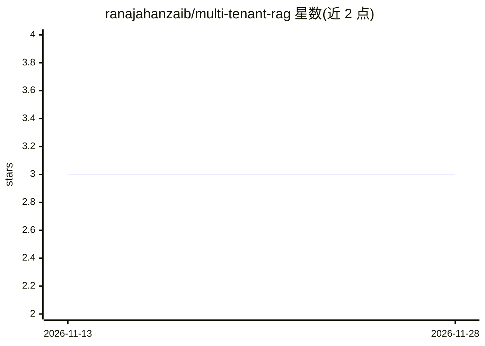

# ranajahanzaib/multi-tenant-rag

⭐ 3 · Python · MIT · 推送 2026-11-25 · [GitHub](https://github.com/ranajahanzaib/multi-tenant-rag) · 个人维护

**面向 SaaS 的多租户权限感知 RAG 参考应用**

以虚构物业管理场景为载体的参考应用：FastAPI + React 前端，PostgreSQL（含 pgvector）作为权威存储，通过强制行级安全（RLS）、事务本地租户上下文与租户感知外键保证每条记录、文档块与引用不跨租户。支持 PDF/Markdown/文本摄取队列、全文+向量检索的倒数排名融合、仅证据回答模式，以及可选本地 Ollama 生成；含聊天历史、审计事件、成员与权限撤销管理。README 明确其为本地参考应用，不含生产部署所需的全部控制。

## 筛选速览

| 维度 | 判定 | 备注 |
|---|---|---|
| AI 角色 | `ai-native` | 本体是模型或模型工具 |
| 许可风险 | `permissive` | MIT |
| 部署形态 | `self-host` | docker 或自建部署 |
| 模型依赖 | local-ok | 支持本地模型 |
| 硬件要求 | — | 无带数字的原话,不猜 |
| 安装摩擦 | `low` | 无编译、无系统依赖或容器化 |
| 成熟度 | — | 结构信号不足 |

## 能力要点

- PostgreSQL 强制 RLS + 事务本地租户上下文实现租户隔离
- 全文检索与 pgvector 向量检索的倒数排名融合
- 默认仅证据（evidence-only）回答，可选本地 Ollama 生成并带引用回退
- 内置安全实验室冒烟套件、API 评估冒烟集与合成种子数据

## 适用场景

- 为 SaaS 应用搭建权限感知的知识检索
- 学习 PostgreSQL RLS 与 pgvector 的组合用法
- 本地演示多租户隔离与角色切换

## 场景标签

`RAG` `文档问答` · 领域:知识与检索

## 证据(README 行号)

> L3: **Secure, tenant-aware AI knowledge retrieval for SaaS applications.**
> L14: - PostgreSQL full-text and pgvector retrieval with reciprocal-rank fusion when the local embedding model is availab
> L15: - Evidence-only lease answers by default, with an optional local Ollama provider, and a React dashboard for leases,

## 星数曲线

2026-11-13 3 → 2026-11-28 3（+0）

---
*卡片 v1 · prompt 1.4 · 生成 2026-11-21 · 置信度 high · 依据 README sha `535b3ef4e6d8` · [字段定义](../../DATASET.md)*
