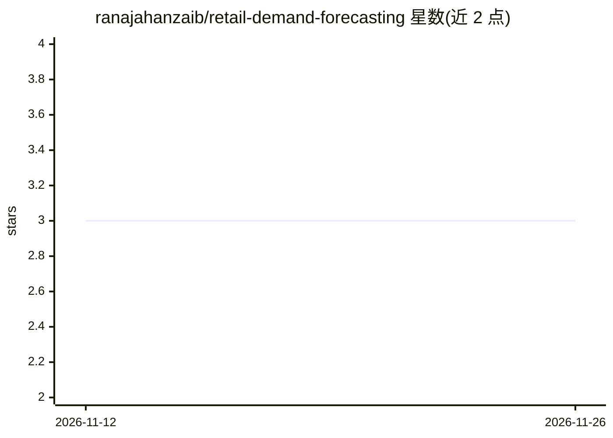

# ranajahanzaib/retail-demand-forecasting

⭐ 3 · Python · MIT · 推送 2026-11-25 · [GitHub](https://github.com/ranajahanzaib/retail-demand-forecasting) · 个人维护

**为零售分析师生成周度需求预测并评估模型可靠性的实验室**

将交易记录转换为周度产品销量，训练池化 LightGBM 模型并与三个统计基线对比，通过时间切分留出集评估 MAE/WAPE/偏差，并输出基于经验残差分位数的 80%/90% 预测区间。架构为本地优先、零数据库：Typer CLI 离线训练，FastAPI 无状态读取文件工件，React 仪表盘查询与模拟需求冲击场景。CPU 训练，附离线合成示例数据；预测仅基于观测销量，不反映缺货损失。

## 筛选速览

| 维度 | 判定 | 备注 |
|---|---|---|
| AI 角色 | `ai-native` | 本体是模型或模型工具 |
| 许可风险 | `permissive` | MIT |
| 部署形态 | `library` | 以包/库形式分发 |
| 模型依赖 | — | README 未给出锁定关系 |
| 硬件要求 | — | 无带数字的原话,不猜 |
| 安装摩擦 | `low` | 无编译、无系统依赖或容器化 |
| 成熟度 | — | 结构信号不足 |

## 能力要点

- LightGBM 多步直接预测（h=1..4）与三个统计基线对比评估
- 基于验证残差的有限样本经验预测区间（80%/90%）
- 需求冲击模拟器带历史 5–95 分位数外的分布外警告
- 零数据库文件工件架构（.parquet/.joblib/.json）

## 适用场景

- 从 Excel/CSV 交易记录生成未来 4 周产品销量预测
- 评估预测模型的可靠性并检验区间覆盖率
- 在假设需求冲击下测试模型敏感度

## 场景标签

`MLOps` · 领域:训练与推理

## 证据(README 行号)

> L5: Retail Demand Forecasting is an open-source, local-first forecasting and model reliability laboratory. It converts t
> L16: - **Direct Multi-Horizon Regression ($h=1..4$):** A pooled LightGBM regressor with 18 origin-bounded lag, rolling, 
> L69: The application implements a **local-first, decoupled, file-artifact-driven architecture**. Analytical model traini

## 星数曲线

2026-11-12 3 → 2026-11-26 3（+0）

---
*卡片 v1 · prompt 1.4 · 生成 2026-11-21 · 置信度 mid · 依据 README sha `df7c63900923` · [字段定义](../../DATASET.md)*
