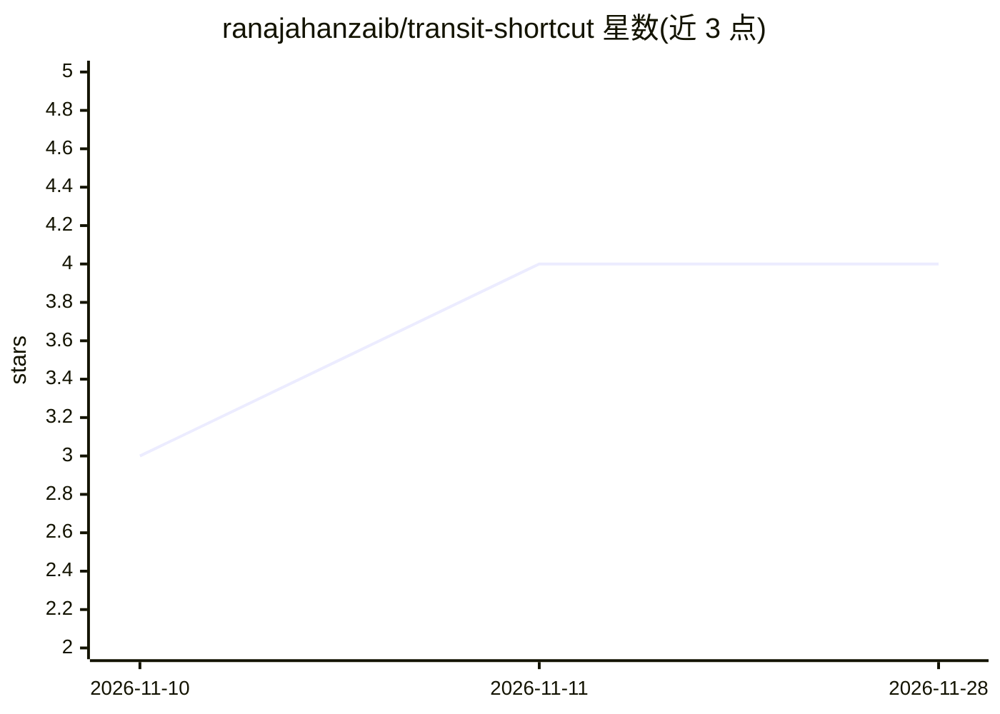

# ranajahanzaib/transit-shortcut

⭐ 4 · TypeScript · MIT · 推送 2026-11-25 · [GitHub](https://github.com/ranajahanzaib/transit-shortcut) · 个人维护

**面向研究者的系外行星分类捷径审计工具集**

TransitShortcut 是一套科学评估软件，用于审计系外行星分类模型中的数据集捷径：它训练一个刻意使用元数据的 Shortcut Model 与一个仅用原始测光特征的 Signal Model，度量工件流行度，并通过逐组移除特征重训练的消融实验比较结果。配套本地 Workstation（FastAPI 后端 + 前端）可浏览真实光变曲线、预测分歧与审计证据；CLI 支持数据准备、训练与 Markdown/JSON/CSV 报告导出。明确声明不用于发现或验证行星。

## 筛选速览

| 维度 | 判定 | 备注 |
|---|---|---|
| AI 角色 | `ai-ecosystem` | LLM/agent 周边工具 |
| 许可风险 | `permissive` | MIT |
| 部署形态 | `None` |  |
| 模型依赖 | — | README 未给出锁定关系 |
| 硬件要求 | `cpu-ok` | |
| 安装摩擦 | `low` | 无编译、无系统依赖或容器化 |
| 成熟度 | — | 结构信号不足 |

## 能力要点

- Shortcut Model 与 raw-photometry Signal Model 双基线对比
- 消融实验：逐组移除特征后重训练并比较 macro F1 与预测变化
- 确定性分层采样与含 SHA256、采样警告的 manifest 记录
- FastAPI Workstation 浏览光变曲线、混淆矩阵与审计热图

## 适用场景

- 核查系外行星分类器是否依赖任务/目录元数据等工件
- 按 Kepler/K2/TESS 分任务评估分类指标与错误重叠
- 导出含复现命令的 Markdown/JSON/CSV 审计报告

## 场景标签

`模型评测` · 领域:评测与运维

## 证据(README 行号)

> L5: TransitShortcut audits shortcuts in exoplanet classification. It compares a deliberately questionable metadata basel
> L7: It is scientific evaluation software. It does not discover or validate planets.
> L58: Both models use scikit-learn Logistic Regression with fixed `C=1`, maximum 2,000 iterations, and the manifest seed.

## 星数曲线

2026-11-10 3 → 2026-11-28 4（+1）

---
*卡片 v1 · prompt 1.4 · 生成 2026-11-21 · 置信度 high · 依据 README sha `a596832e620f` · [字段定义](../../DATASET.md)*
