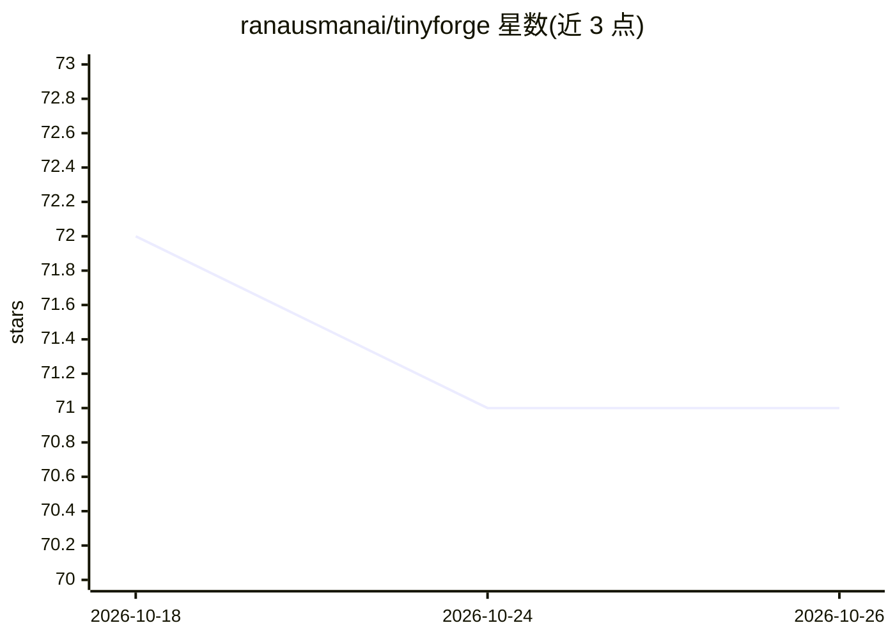

# ranausmanai/tinyforge

⭐ 71 · Python · 推送 2026-03-10 · [GitHub](https://github.com/ranausmanai/tinyforge) · 个人维护

**笔记本上自我改进的小模型：从测试失败中自我训练写代码**

基于 MLX 在 Apple Silicon 笔记本上运行的自我改进框架：0.8B Qwen 模型在沙盒子进程中解代码题，通过进化搜索（生成-测试-选择-变异）寻找更优解，抽取弱/强解对作为修复训练数据，用 QLoRA（LoRA rank 4）在 6.5-13GB 内存内微调自身，无需云端、教师模型或人工反馈。支持自定义 JSONL 任务，方法可推广到任何可自动验证输出的领域。结果在 HumanEval 切片上验证，作者自述范围有限、增益来自系统而非模型本身。

## 筛选速览

| 维度 | 判定 | 备注 |
|---|---|---|
| AI 角色 | `ai-native` | 本体是模型或模型工具 |
| 许可风险 | `permissive` | — |
| 部署形态 | `library` | 以包/库形式分发 |
| 模型依赖 | — | README 未给出锁定关系 |
| 硬件要求 | — | 无带数字的原话,不猜 |
| 安装摩擦 | `low` | 无编译、无系统依赖或容器化 |
| 成熟度 | `idea` | |

## 能力要点

- 进化搜索循环：生成-沙盒测试-选择-按失败反馈变异
- 弱/强解对抽取为修复训练数据，MLX LoRA（rank 4）40 次迭代完成微调
- 峰值内存 6.5-13GB，MacBook Air M4 可运行
- 支持自定义 JSONL 任务，扩展到 SQL/数学证明/ETL 等可验证领域

## 适用场景

- 在无 GPU 的 Mac 上复现小模型自我改进实验
- 为自有代码任务构建自动生成-测试-修复训练闭环
- 研究测试驱动自我训练技术在其他可验证领域的迁移

## 场景标签

`代码生成` `微调` · 领域:编码与开发

## 证据(README 行号)

> L21: The model tries to solve coding problems. It fails. It sees *exactly* what failed (which test, what input, what it 
> L139: 1. **🌱 Seed** — Generate `population_size` candidate solutions
> L165: |Method|MLX LoRA (4-bit quantized base + low-rank adapters)|

## 星数曲线

2026-10-18 72 → 2026-10-26 71（-1）

---
*卡片 v1 · prompt 1.4 · 生成 2026-10-24 · 置信度 mid · 依据 README sha `cc3301cafcf1` · [字段定义](../../DATASET.md)*
