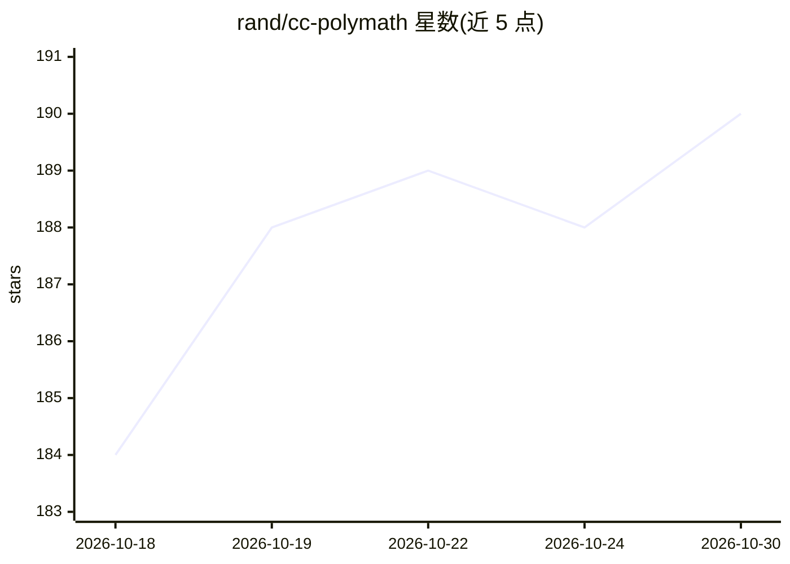

# rand/cc-polymath

⭐ 190 · Python · MIT · 推送 2026-02-28 · [GitHub](https://github.com/rand/cc-polymath) · 个人维护

**面向 Claude Code 的 410+ 原子开发技能库与渐进式发现插件**

Claude Code 插件，收录 410+ 个自包含的原子技能，覆盖后端/前端/云基础设施/数据库/ML/形式方法/高等数学等领域，解决“加载全部知识占用上下文”与“覆盖不足”的取舍问题。机制为三层架构：23 个按关键词自动激活的网关技能、30 个按需加载的类目索引、单个按需加载的技能文档；启动时零加载，宣称上下文占用较整体式索引降低 60-84%。通过 /plugin 命令安装。

## 筛选速览

| 维度 | 判定 | 备注 |
|---|---|---|
| AI 角色 | `ai-knowledge` | 知识聚合/清单类 |
| 许可风险 | `permissive` | MIT |
| 部署形态 | `self-host` | docker 或自建部署 |
| 模型依赖 | — | README 未给出锁定关系 |
| 硬件要求 | — | 无带数字的原话,不猜 |
| 安装摩擦 | `low` | 无编译、无系统依赖或容器化 |
| 成熟度 | — | 结构信号不足 |

## 能力要点

- 410+ 原子技能，平均 320 行、单一职责、可组合
- 三层渐进发现：网关技能→类目索引→单个技能，按关键词自动激活
- 覆盖 23 个领域：云、数据库、ML/DSPy、形式方法、WebAssembly/eBPF 等
- 提供 /skills 命令与安装校验脚本

## 适用场景

- 让 Claude Code 在编码时按需获得领域最佳实践而不过度消耗上下文
- 组合多个技能指导全栈应用、ML 部署、缓存策略等复杂工作流
- 查找从云基础设施到形式方法、高等数学的开发知识参考

## 场景标签

`提示工程` · 领域:Agent 开发

## 证据(README 行号)

> L30: This repository solves a tradeoff problem: how to give Claude Code access to comprehensive development knowledge wi
> L43: ### Atomic Skills (410+ total)

## 星数曲线

2026-10-18 184 → 2026-10-30 190（+6）

---
*卡片 v1 · prompt 1.4 · 生成 2026-10-22 · 置信度 mid · 依据 README sha `7ee038622ce2` · [字段定义](../../DATASET.md)*
