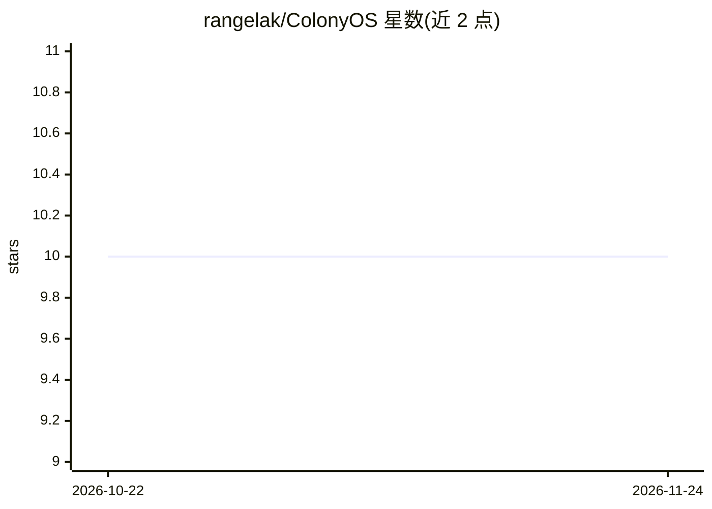

# rangelak/ColonyOS

⭐ 10 · Python · MIT · 推送 2026-04-13 · [GitHub](https://github.com/rangelak/ColonyOS) · [官网](https://pypi.org/project/colonyos/) · 个人维护

**把提示词自动变为已提交 PR 的自主 AI 开发流水线 CLI**

面向开发者的自主软件工程流水线：输入功能描述或 GitHub issue，依次生成 PRD、分解任务、先写测试再实现、并行多角色只读评审、修复循环、GO/NO-GO 决策门，最后推送分支并开启 PR。底层通过 Claude Agent SDK 编排多阶段隔离的 agent 会话，每个阶段有独立指令模板与预算上限；支持 CEO agent 自主决定开发内容的 auto 模式、循环与美元预算上限、Slack 集成、本地 Web 仪表盘及成本统计。依赖 Claude Code CLI、Git、GitHub CLI。

## 筛选速览

| 维度 | 判定 | 备注 |
|---|---|---|
| AI 角色 | `ai-native` | 本体是模型或模型工具 |
| 许可风险 | `permissive` | MIT |
| 部署形态 | `library` | 以包/库形式分发 |
| 模型依赖 | locked-api |  |
| 硬件要求 | — | 无带数字的原话,不猜 |
| 安装摩擦 | `low` | 无编译、无系统依赖或容器化 |
| 成熟度 | — | 结构信号不足 |

## 能力要点

- 多阶段流水线：PRD→测试先行实现→并行多角色评审→修复循环→GO/NO-GO 决策门→开 PR
- CEO agent 自主模式（colonyos auto），支持循环次数、时长与美元预算上限
- colonyos doctor 环境自检、CI 失败日志自动修复、PR 评审评论自动处理
- Slack 集成、本地 Web 仪表盘（默认端口 7400）与运行成本分析

## 适用场景

- 把 GitHub issue 或一句描述自动变成带测试与 PRD 的 PR
- 夜间无人值守连续执行多个开发循环并控制预算
- 对任意分支做多角色独立代码评审并自动修复问题

## 场景标签

`编码 Agent` `代码审查` · 领域:编码与开发

## 证据(README 行号)

> L14: ColonyOS is an autonomous software engineering pipeline. Give it a feature description — or let its built-in CEO ag
> L16: Under the hood it orchestrates Claude agent sessions via the Claude Agent SDK with full codebase awareness. Point i

## 星数曲线

2026-10-22 10 → 2026-11-24 10（+0）

---
*卡片 v1 · prompt 1.4 · 生成 2026-11-19 · 置信度 mid · 依据 README sha `a94ad3c9798c` · [字段定义](../../DATASET.md)*
