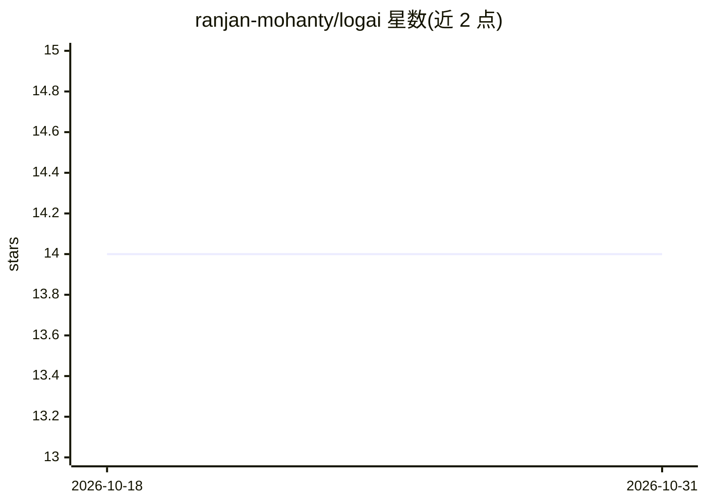

# ranjan-mohanty/logai

⭐ 14 · Rust · MIT · 推送 2026-03-30 · [GitHub](https://github.com/ranjan-mohanty/logai) · 个人维护

**AI 驱动的日志分析 CLI：解析、聚类错误并给出修复建议**

Rust 编写的命令行日志分析工具：自动检测 JSON、纯文本、Apache、Nginx、Syslog 等格式，解析多行日志（堆栈、JSON 对象），按动态值归一化聚类相似错误并去重统计；可选调用 AI（OpenAI/Claude/Gemini/Ollama/AWS Bedrock）解释错误并给出修复建议，支持并行请求、指数退避重试与本地响应缓存。输出支持彩色终端、HTML 报告与 JSON 格式，支持 stdin 管道、TOML 配置文件与 MCP 协议接入外部工具，跨 Linux/macOS/Windows 平台。

## 筛选速览

| 维度 | 判定 | 备注 |
|---|---|---|
| AI 角色 | `ai-native` | 本体是模型或模型工具 |
| 许可风险 | `permissive` | MIT |
| 部署形态 | `library` | 以包/库形式分发 |
| 模型依赖 | local-ok | 支持本地模型 |
| 硬件要求 | — | 无带数字的原话,不猜 |
| 安装摩擦 | `low` | 无编译、无系统依赖或容器化 |
| 成熟度 | — | 结构信号不足 |

## 能力要点

- 多格式日志解析与自动格式检测，多行日志与元数据提取
- 基于动态值归一化的错误聚类与去重统计
- 5 个 AI 提供商可选，并行分析、重试与响应缓存
- 终端/HTML/JSON 三种输出，支持 MCP 集成与 CI/CD 退出码

## 适用场景

- 排查应用日志中反复出现的错误并获取修复建议
- 在 CI/CD 中自动化分析日志并以 JSON/退出码集成
- 配合本地 Ollama 免费分析日志，不产生 API 费用

## 场景标签

 · 领域:开发运维/日志分析

## 证据(README 行号)

> L13: **AI-powered log analysis** - Parse, group, and understand your logs with AI.
> L400: 4. **Analyze** - Uses AI to explain errors and suggest fixes (optional)

## 星数曲线

2026-10-18 14 → 2026-10-31 14（+0）

---
*卡片 v1 · prompt 1.4 · 生成 2026-10-31 · 置信度 high · 依据 README sha `602e6d7ac0af` · [字段定义](../../DATASET.md)*
