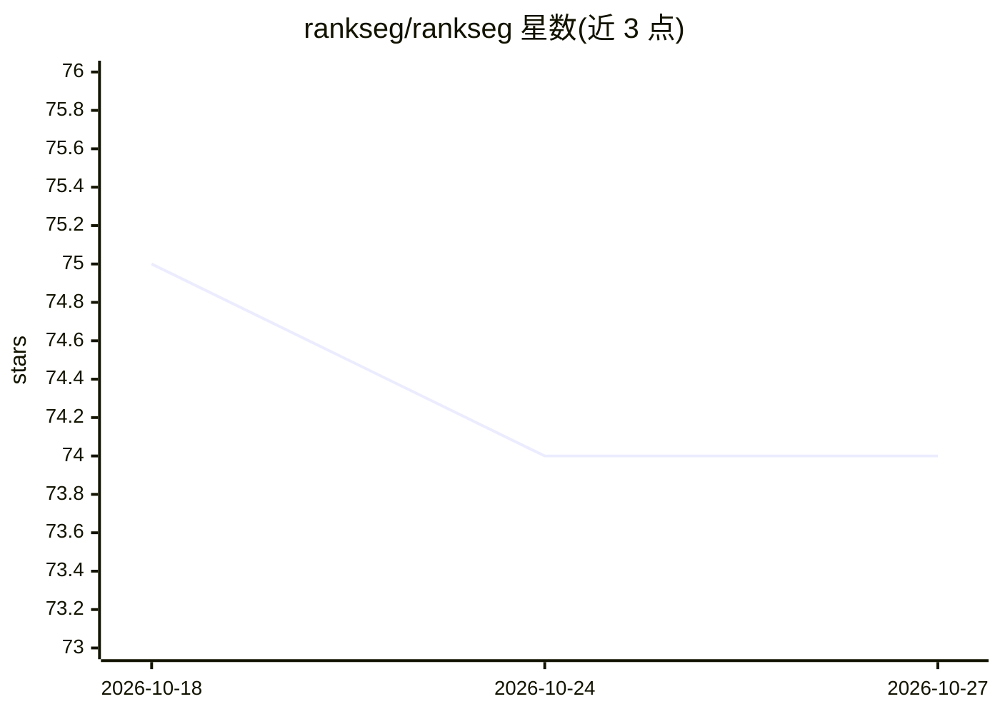

# rankseg/rankseg

⭐ 74 · Jupyter Notebook · BSD-3-Clause · 推送 2026-10-18 · [GitHub](https://github.com/rankseg/rankseg) · [官网](https://rankseg.readthedocs.io/) · 组织维护 · 中文 README

**免重训的分割后处理库：以 Dice/IoU 为目标的解码替换 argmax**

面向 PyTorch 分割模型的指标感知后处理库：用优化后的解码替换 argmax 或固定阈值，直接作用于冻结模型输出的概率图，支持多类、二值与多标签任务，覆盖自然图像与 3D 医学影像。提供 PyPI 安装与可选 CUDA 加速包，集成文档覆盖 PyTorch、Hugging Face、SAM 系列、MONAI（官方教程）与社区维护的 PaddleSeg 分支。算法发表于 JMLR 2023 与 NeurIPS 2025，README 注明研究用途。

## 筛选速览

| 维度 | 判定 | 备注 |
|---|---|---|
| AI 角色 | `ai-native` | 本体是模型或模型工具 |
| 许可风险 | `permissive` | BSD-3-Clause |
| 部署形态 | `library` | 以包/库形式分发 |
| 模型依赖 | — | README 未给出锁定关系 |
| 硬件要求 | — | 无带数字的原话,不猜 |
| 安装摩擦 | `low` | 无编译、无系统依赖或容器化 |
| 成熟度 | — | 结构信号不足 |

## 能力要点

- 替换 argmax/阈值解码，直接优化 Dice/IoU，无需重训或微调
- 支持多类、二值、多标签任务与 3D 医学影像
- 提供 pip 安装与可选 Linux x86-64 CUDA 加速扩展
- 与 PyTorch/Hugging Face/SAM/MONAI 集成，算法发表 JMLR 与 NeurIPS

## 适用场景

- 冻结分割模型上通过后处理提升 Dice/IoU
- 3D 医学影像分割（如 CT 胰腺）在不重训下改进输出
- 在 MONAI/PaddleSeg 工作流中替换默认解码步骤

## 场景标签

`目标检测` · 领域:感知与多模态

## 证据(README 行号)

> L20: **RankSEG** replaces `argmax` or fixed thresholds with metric-aware post-processing
> L22: Use it with frozen PyTorch segmentation models for multiclass, binary, and
> L53: preds = RankSEG(metric="dice")(probs)  # replaces argmax; shape: (batch, *spatial)

## 星数曲线

2026-10-18 75 → 2026-10-27 74（-1）

---
*卡片 v1 · prompt 1.4 · 生成 2026-10-24 · 置信度 high · 依据 README sha `646a41650c93` · [字段定义](../../DATASET.md)*
