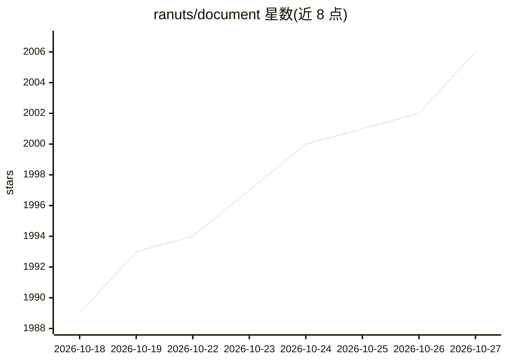

# ranuts/document

⭐ 2,006 · TypeScript · AGPL-3.0 · 推送 2026-10-26 · [GitHub](https://github.com/ranuts/document) · [官网](https://edit.chaxus.com/) · 个人维护 · 中文 README

**本地优先的浏览器 Office 文档编辑器，附实验性 AI 助手**

基于 OnlyOffice（sdkjs/web-apps + WASM 转换器）改造的浏览器端文档工作区，支持打开、编辑、转换 docx/xlsx/pptx 并批注 PDF，核心处理在本地运行，无需账号或安装 Office。AI 部分为实验性 Beta（默认关闭）：可起草与润色文本、处理表格数据、创建幻灯片、就当前 PDF 页提问，支持设备端模型或自有 AI 服务；另通过 WebMCP 让浏览器 agent 调用文档工具。可自托管、经 iframe 嵌入或作为 PWA 安装。

## 筛选速览

| 维度 | 判定 | 备注 |
|---|---|---|
| AI 角色 | `ai-enhanced` | 去掉 AI 部分产品仍成立 |
| 许可风险 | `viral` | AGPL-3.0 |
| 部署形态 | `self-host` | docker 或自建部署 |
| 模型依赖 | — | README 未给出锁定关系 |
| 硬件要求 | — | 无带数字的原话,不猜 |
| 安装摩擦 | `low` | 无编译、无系统依赖或容器化 |
| 成熟度 | `idea` | |

## 能力要点

- 浏览器内本地编辑 Word/Excel/PowerPoint 并批注 PDF，无需上传文档
- 实验性 AI 助手：起草文本、表格处理、幻灯片创建、PDF 页问答，改动需人工确认
- WebMCP 通道允许兼容浏览器中的 AI agent 调用文档工具
- 支持自托管、iframe 嵌入 API 与 PWA 离线缓存

## 适用场景

- 不装 Office 也不想上传文件，直接在浏览器里编辑 Office 文档
- 让 AI 助手起草文本、填充表格或生成幻灯片并审阅后应用
- 自托管或嵌入到自己的应用中提供文档编辑能力

## 场景标签

`AI 助手` · 领域:对话与助手

## 证据(README 行号)

> L27: Open, edit, convert and save Word, Excel and PowerPoint files, and annotate PDFs in your browser. Core document pro
> L37: - **Work with AI (Experimental Beta).** Draft and refine text, work with spreadsheet data, create slides or ask abo
> L29: Use optional AI assistance (Experimental Beta), let browser agents call document tools through WebMCP, or install i

## 星数曲线

2026-10-18 1,989 → 2026-10-27 2,006（+17）

---
*卡片 v1 · prompt 1.4 · 生成 2026-10-21 · 置信度 mid · 依据 README sha `88378c84a7cb` · [字段定义](../../DATASET.md)*
