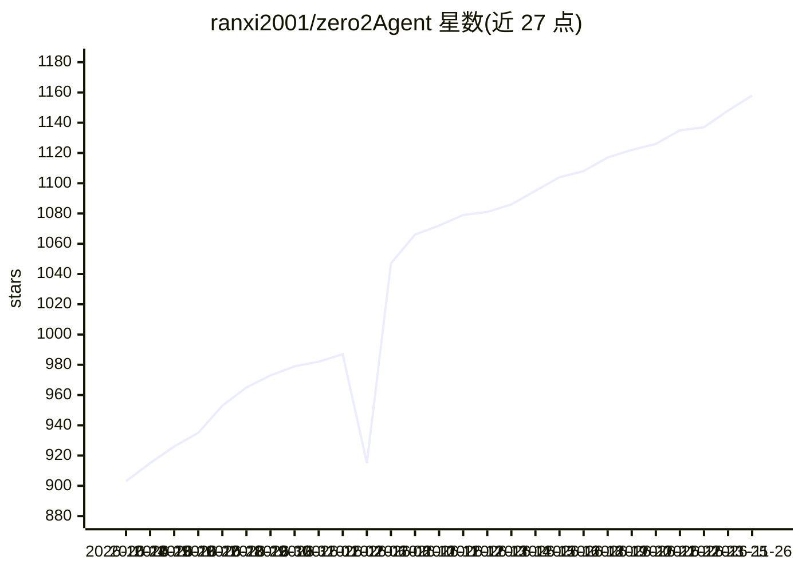

# ranxi2001/zero2Agent

⭐ 1,158 · Python · MIT · 推送 2026-11-25 · [GitHub](https://github.com/ranxi2001/zero2Agent) · [官网](https://onefly.top/zero2Agent/) · 个人维护 · 中文 README

**面向程序员的 Agent 工程教程与大厂面试题库网站**

zero2Agent 是一个以 GitHub Pages 在线阅读的 Agent 工程教程仓库，面向会写代码但缺 Agent 工程经验的开发者与求职者，含 133 篇文章、12 个完整模块，覆盖 Agent 基础概念、LangGraph、三大原厂 SDK、13 个框架调研、Claude Code/Pi/Codex CLI 等 Coding Agent 拆解、训练实战与面试通关。附《Agent 面试 800 问》绿皮书 PDF 与 868 题在线题库（CC BY-NC-SA 4.0，正文仓库为 MIT）。本地通过 git clone 后以 Jekyll 运行。

## 筛选速览

| 维度 | 判定 | 备注 |
|---|---|---|
| AI 角色 | `ai-knowledge` | 知识聚合/清单类 |
| 许可风险 | `permissive` | MIT |
| 部署形态 | `None` |  |
| 模型依赖 | — | README 未给出锁定关系 |
| 硬件要求 | — | 无带数字的原话,不猜 |
| 安装摩擦 | `low` | 无编译、无系统依赖或容器化 |
| 成熟度 | — | 结构信号不足 |

## 能力要点

- 133 篇文章、12 个完整模块的 Agent 工程教程体系
- 覆盖 17 大考察维度、868 道在线题库的 Agent 面试题拆解
- Final Project OfferPilot：手写 10 层 Harness 的面试诊断 Agent 实战
- 支持 Jekyll 本地运行与在线阅读

## 适用场景

- 准备大厂 AI Agent 方向技术面试或实习
- 系统补齐从概念到生产的 Agent 工程能力
- 了解 13 个主流 Agent 框架的横向对比
- 参考 OfferPilot 项目把 Agent 系统部署上线

## 场景标签

`教程课程` · 领域:学习与行业

## 证据(README 行号)

> L28: **zero2Agent** 是一个面向程序员的 Agent 工程教程仓库，目标是帮助已经会写代码、会用 AI 工具，但还没系统做过 Agent 工程的开发者，真正从零搭出自己的 Agent 系统。同时也适合应届生或转行开发者，作
> L32: **在线阅读（GitHub Pages）**：https://onefly.top/zero2Agent

## 星数曲线

2026-10-24 903 → 2026-11-26 1,158（+255）

---
*卡片 v1 · prompt 1.4 · 生成 2026-11-24 · 置信度 mid · 依据 README sha `85926101b29f` · [字段定义](../../DATASET.md)*
