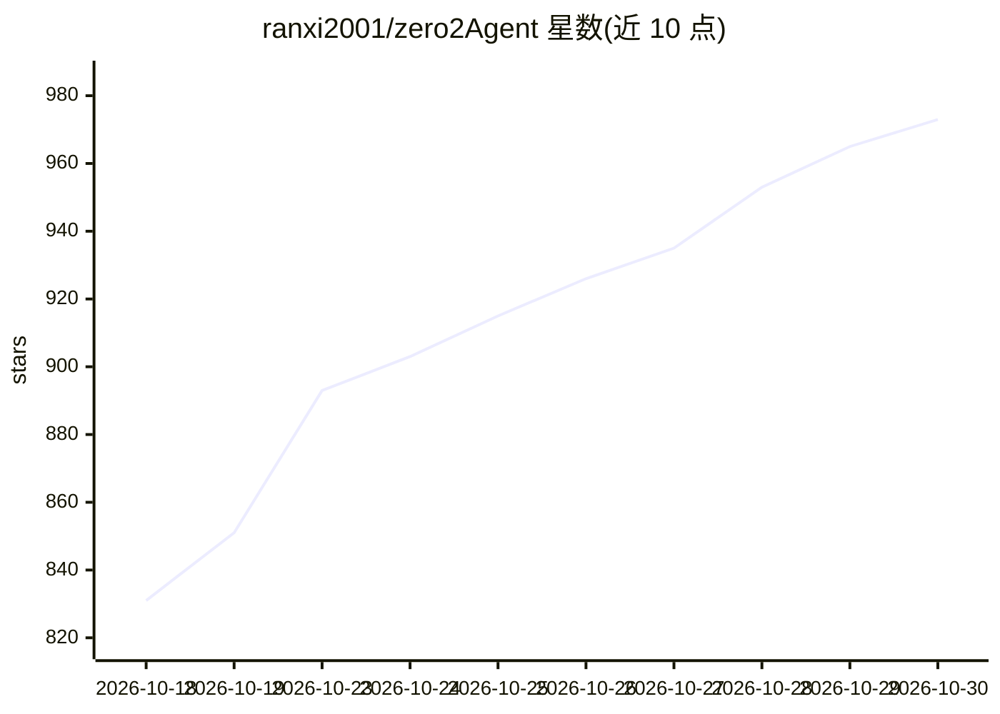

# ranxi2001/zero2Agent

⭐ 973 · Python · MIT · 推送 2026-10-29 · [GitHub](https://github.com/ranxi2001/zero2Agent) · [官网](https://onefly.top/zero2Agent/) · 个人维护 · 中文 README

**面向程序员的 Agent 工程教程站：从零搭 Agent 到面试备战**

GitHub Pages 在线教程仓库，共 133 篇文章、12 个完整模块，覆盖 Agent 基础概念、LangGraph、三大原厂 SDK、13 个框架调研、OpenClaw/Claude Code/DeepSeek Harness/Pi/Codex CLI 等实现拆解、Agent 训练与实战、17 个维度的大厂面试题及 Final Project（OfferPilot 面试诊断 Agent，纯手写 Harness 10 层架构）。面向会写代码但未系统做过 Agent 工程的开发者及面试备战人群。教程主体 MIT 许可，附《Agent 面试 800 问》绿皮书 PDF 采用 CC BY-NC-SA 4.0。

## 筛选速览

| 维度 | 判定 | 备注 |
|---|---|---|
| AI 角色 | `ai-knowledge` | 知识聚合/清单类 |
| 许可风险 | `permissive` | MIT |
| 部署形态 | `None` |  |
| 模型依赖 | — | README 未给出锁定关系 |
| 硬件要求 | — | 无带数字的原话,不猜 |
| 安装摩擦 | `low` | 无编译、无系统依赖或容器化 |
| 成熟度 | — | 结构信号不足 |

## 能力要点

- 133 篇文章、12 个完整模块，含框架调研与面试通关
- 《Agent 面试 800 问》绿皮书（828 题，17 大维度，新手答 vs 高手答）
- Final Project OfferPilot：手写 Harness 10 层架构面试诊断 Agent
- 本地 git clone 后以 Jekyll 方式运行阅读

## 适用场景

- 系统学习 Agent 工程并动手搭建自己的 Agent 系统
- 备战大厂 AI Agent 岗位技术面试
- 横向了解主流 Agent 框架与 SDK 的设计差异

## 场景标签

`教程课程` · 领域:学习与行业

## 证据(README 行号)

> L26: **zero2Agent** 是一个面向程序员的 Agent 工程教程仓库，目标是帮助已经会写代码、会用 AI 工具，但还没系统做过 Agent 工程的开发者，真正从零搭出自己的 Agent 系统。同时也适合应届生或转行开发者，作
> L35: ## 模块概览

## 星数曲线

2026-10-18 831 → 2026-10-30 973（+142）

---
*卡片 v1 · prompt 1.4 · 生成 2026-10-21 · 置信度 mid · 依据 README sha `269046662ed9` · [字段定义](../../DATASET.md)*
