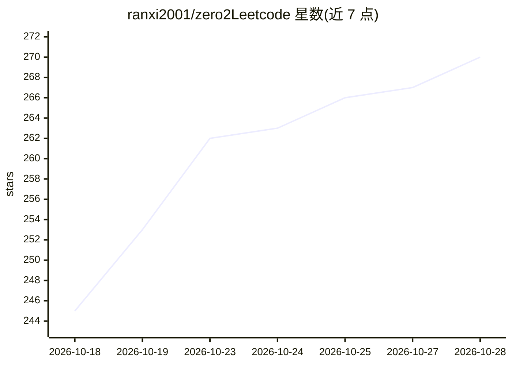

# ranxi2001/zero2Leetcode

⭐ 272 · JavaScript · 推送 2026-10-28 · [GitHub](https://github.com/ranxi2001/zero2Leetcode) · [官网](https://onefly.top/zero2Leetcode/) · 个人维护 · 中文 README

**从零基础到算法面试的 Python/LeetCode 学习平台，带 AI 编程教练**

面向校招、社招及转码学习者的在线学习平台：6 阶段课程覆盖 Python 基础、数据结构、核心算法、LeetCode Hot 100 刷题与企业笔试面试备战，附 116 道题的在线练习场与 ACM 模拟 IDE（stdin/stdout、样例判定、Python 断点调试）。Python 经 Pyodide 浏览器内执行，Java 17 经 CheerpJ+ECJ 浏览器内编译，Go 使用官方 Playground，无需本地环境。AI 教练基于 Responses API 的内置服务（默认 Tosky gpt-6-luna），可给提示、诊断代码并生成 Java/Go 转换，自定义服务需支持 CORS 与 SSE。内置服务端到端验证尚未确认通过；Java 支持处于 Preview。

## 筛选速览

| 维度 | 判定 | 备注 |
|---|---|---|
| AI 角色 | `ai-enhanced` | 去掉 AI 部分产品仍成立 |
| 许可风险 | `none` | — |
| 部署形态 | `None` |  |
| 模型依赖 | — | README 未给出锁定关系 |
| 硬件要求 | — | 无带数字的原话,不猜 |
| 安装摩擦 | `medium` | 含编译或系统依赖之一 |
| 成熟度 | `idea` | |

## 能力要点

- 在线练习场 116 题，Python/Java 17/Go 均在浏览器内编译运行，无需本地环境
- ACM 模拟 IDE 支持 stdin/stdout、期望输出自动判定与 Python 断点调试
- AI 教练读取当前题目与代码上下文，提供提示、诊断与 Java 17/Go 语言转换
- 6 阶段学习路线与 LeetCode Hot 100 全部 Python 题解

## 适用场景

- 零基础系统学习 Python 并准备算法笔试面试
- 在浏览器内直接刷 LeetCode 核心代码题并验证样例
- 训练企业笔试的 ACM 标准输入输出模式
- 卡题时向 AI 教练请求提示并用样例验证返回代码

## 场景标签

`教程课程` · 领域:学习与行业

## 证据(README 行号)

> L14: Zero2Leetcode 面向准备校招、社招及转码的学习者，将 Python 基础、数据结构、算法题解、企业笔试真题和面试训练串成一条学习路线。在线练习场与 AI 教练提供代码运行、样例验证和解题指导。
> L58: 默认服务与模型仍为 Tosky `gpt-6-luna`，AI 传输层使用 Responses API：请求 `/responses`，设置 `stream:true`、`store:false`，由客户端携带对话历史。自定义服务
> L60: AI 教练同时用于两个编程页面：在 LeetCode 练习场读取当前题目、语言、核心代码模板与草稿，给出当前语言的提示、诊断或实现；在 ACM 模拟 IDE 读取当前语言、代码、stdin、stdout、期望输出和运行状态，并生成

## 星数曲线

2026-10-18 245 → 2026-10-28 270（+25）

---
*卡片 v1 · prompt 1.4 · 生成 2026-10-23 · 置信度 high · 依据 README sha `4a262806683b` · [字段定义](../../DATASET.md)*
