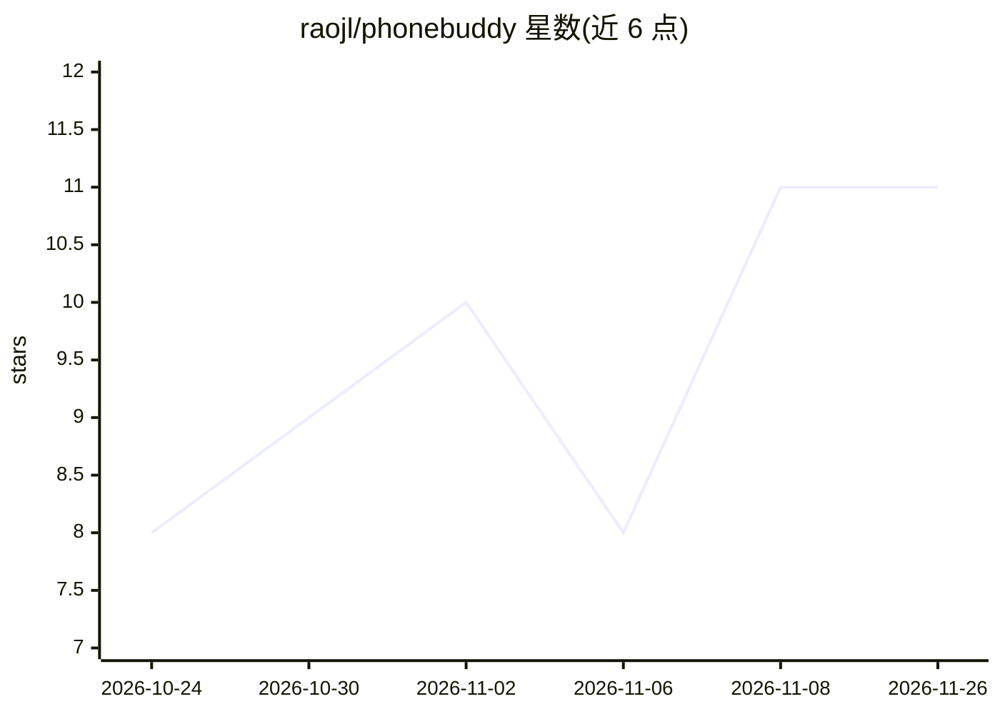

# raojl/phonebuddy

⭐ 11 · Rust · MIT · 推送 2026-09-22 · [GitHub](https://github.com/raojl/phonebuddy) · 个人维护 · 中文 README

**给客服场景用的 SIP 软电话 AI Agent，接听/外呼并用语音对话**

基于 Rust + PJSIP + Tauri 2 的桌面 AI 电话客服应用：注册到标准 SIP 系统（老式 PBX / Asterisk / 公网 SIP 服务商）后自动接听来电或主动外呼。链路为 PJSIP 音频 → 腾讯云 ASR 流式转写 → DeepSeek 大模型（OpenAI 兼容、带 Function Calling）→ 腾讯云 TTS 按句合成播放，支持语音打断。技能用 Markdown 定义并运行时热加载，会话落 SQLite/JSONL。仅 Windows 环境从源码构建，需配置 DeepSeek 与腾讯云密钥。

## 筛选速览

| 维度 | 判定 | 备注 |
|---|---|---|
| AI 角色 | `ai-native` | 本体是模型或模型工具 |
| 许可风险 | `permissive` | MIT |
| 部署形态 | `desktop` | 安装包/桌面程序 |
| 模型依赖 | locked-api |  |
| 硬件要求 | — | 无带数字的原话,不猜 |
| 安装摩擦 | `medium` | 含编译或系统依赖之一 |
| 成熟度 | — | 结构信号不足 |

## 能力要点

- 实时语音通话链路：PJSIP → ASR → 大模型 → TTS，首句约 1 秒
- 语音打断（Barge-in）：客户开口即停止播报转入倾听
- Markdown 技能系统，运行时热加载，按 trigger 关键词路由工具
- 业务工具：查客户、查订单、下单、建工单、查知识库

## 适用场景

- 让 AI 自动接听门店订餐/预约电话
- 通过 SIP 外呼向客户做业务通知
- 在固定话术场景用预录音拼接替代实时 TTS

## 场景标签

`语音 Agent` · 领域:对话与助手

## 证据(README 行号)

> L3: > 会打电话的 AI 客服 —— 让大模型真正拿起电话听、思考、开口说。
> L5: phoneBuddy 是一个基于 **Rust + PJSIP + Tauri 2** 的桌面版 AI 智能电话客服。它可以注册到标准 SIP 电话系统（老式 PBX / Asterisk / 公网 SIP 服务商），自动接听来电或
> L11: 客户说话 ──RTP──▶ PJSIP ──▶ ASR 语音识别 ──▶ 大模型(DeepSeek) ──▶ TTS 语音合成 ──RTP──▶ 客户听到

## 星数曲线

2026-10-24 8 → 2026-11-26 11（+3）

---
*卡片 v1 · prompt 1.4 · 生成 2026-11-18 · 置信度 mid · 依据 README sha `71862d667c6e` · [字段定义](../../DATASET.md)*
