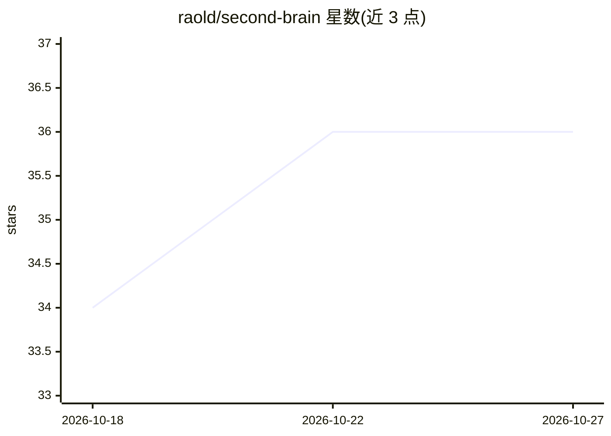

# raold/second-brain

⭐ — · [GitHub]() · 个人维护

**本地自托管的个人 AI 知识管理系统，多模态存取与检索**

自托管的第二大脑系统：以 Docker Compose 编排 FastAPI、PostgreSQL+pgvector 与本地模型服务（LM Studio 运行 LLaVA 1.6 Mistral 7B 做文本/视觉生成，CLIP 做图像嵌入，Nomic 做文本嵌入），提供记忆 CRUD、语义/混合/图像相似度搜索、知识图谱、Google Drive OAuth 流式同步与 OCR 等 REST API。全程无需 API key、可离线运行。需 Docker Desktop，建议 16GB+ 内存与 20GB+ 磁盘；GPU 服务为可选 compose 文件。Ollama 集成在路线图中尚未实现。

## 筛选速览

| 维度 | 判定 | 备注 |
|---|---|---|
| AI 角色 | `ai-native` | 本体是模型或模型工具 |
| 许可风险 | `viral` | — |
| 部署形态 | `self-host` | docker 或自建部署 |
| 模型依赖 | — | README 未给出锁定关系 |
| 硬件要求 | — | 无带数字的原话,不猜 |
| 安装摩擦 | `low` | 无编译、无系统依赖或容器化 |
| 成熟度 | — | 结构信号不足 |

## 能力要点

- 本地模型栈：LLaVA 文本/视觉、CLIP 图像嵌入、Nomic 文本嵌入（768 维）
- 文本/图像/混合多模态搜索与知识图谱自动关系发现
- Google Drive OAuth 2.0 流式同步，不落地存储
- 无 API key、无云端依赖，Docker Compose 一键启动

## 适用场景

- 把笔记、文档、图片集中存入私有知识库并语义检索
- 分析论文与图片（OCR、视觉理解）建立关联
- 不想把个人数据上云的本地文档管理

## 场景标签

`知识库管理` `知识图谱` `语义搜索` `多模态` · 领域:知识与检索

## 证据(README 行号)

> L16: Second Brain is your personal AI-powered knowledge management system that runs **100% locally** on your machine. St
> L21: - **LM Studio** (port 1234): Text generation with LLaVA 1.6 Mistral 7B

## 星数曲线

2026-10-18 34 → 2026-10-27 36（+2）

---
*卡片 v1 · prompt 1.4 · 生成 2026-10-25 · 置信度 high · 依据 README sha `b1612e202316` · [字段定义](../../DATASET.md)*
