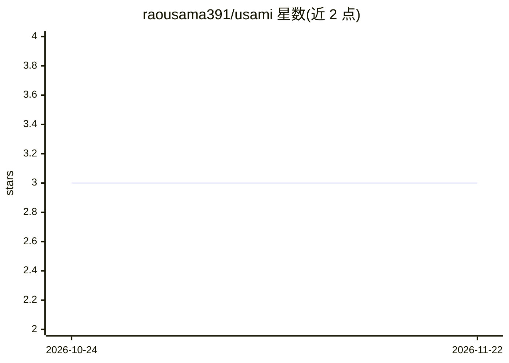

# raousama391/usami

⭐ 3 · Swift · MIT · 推送 2026-10-16 · [GitHub](https://github.com/raousama391/usami) · 个人维护

**macOS 全系统 AI 写作助手：任意应用中改写、翻译选中文本**

原生 macOS 菜单栏应用，基于 Swift/SwiftUI，约 2,000 行代码、无第三方依赖。通过 macOS Accessibility API 读取任意应用中选中的文本，弹出卡片调用用户自己的 Claude 或 ChatGPT 订阅完成改写、翻译（14 种语言）、缩写等操作，接受结果后原位替换文本。无自建服务器与分析；token 存储在本机。限制：仅支持 macOS 14+，无实时下划线标注与查重，定位为按需改写工具。

## 筛选速览

| 维度 | 判定 | 备注 |
|---|---|---|
| AI 角色 | `ai-native` | 本体是模型或模型工具 |
| 许可风险 | `permissive` | MIT |
| 部署形态 | `desktop` | 安装包/桌面程序 |
| 模型依赖 | locked-api |  |
| 硬件要求 | — | 无带数字的原话,不猜 |
| 安装摩擦 | `low` | 无编译、无系统依赖或容器化 |
| 成熟度 | — | 结构信号不足 |

## 能力要点

- 通过 Accessibility API 在任意 macOS 应用中就地改写选中文本
- 复用用户已有的 Claude（Pro/Max）或 ChatGPT（Plus/Pro）订阅，无独立收费
- Claude 请求经 Claude Code CLI 发送，ChatGPT 无需额外组件
- MIT 许可、无服务器无分析，仅发送用户选中的文本

## 适用场景

- 在邮件、Slack、笔记等应用里随时修正语法并润色表达
- 选中文本一键翻译成 14 种语言
- 把选中的段落改得更正式、更口语或压缩为摘要

## 场景标签

`AI 写作` · 领域:内容生成

## 证据(README 行号)

> L6:  Select text in any app, then improve, rephrase or translate it with AI —
> L21: Usami is a small native macOS menu-bar app: a **system-wide AI writing assistant** that works like a grammar checke

## 星数曲线

2026-10-24 3 → 2026-11-22 3（+0）

---
*卡片 v1 · prompt 1.4 · 生成 2026-11-21 · 置信度 high · 依据 README sha `5121d55c28fb` · [字段定义](../../DATASET.md)*
