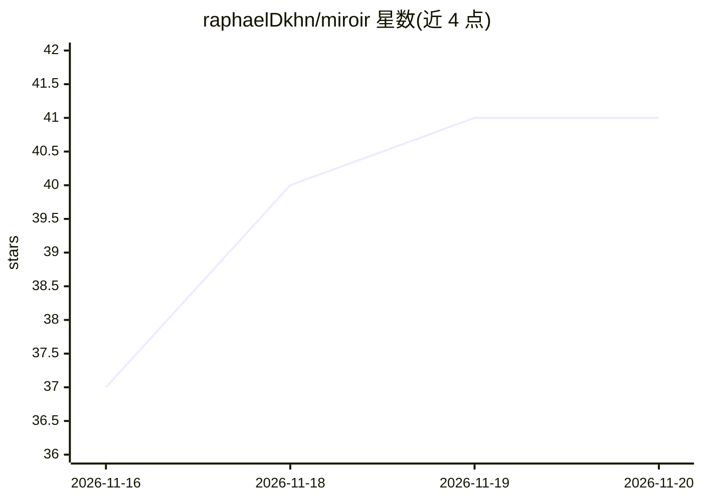

# raphaelDkhn/miroir

⭐ 41 · Rust · Apache-2.0 · 推送 2026-11-19 · [GitHub](https://github.com/raphaelDkhn/miroir) · [官网](miroir.mintlify.site) · 个人维护

**把真实产品打包成 Agent 强化学习环境的工具**

通过在产品的 Docker 镜像中添加 manifest 与任务，将真实应用封装为可用于训练和评估 agent 的环境。Miroir 负责数据播种、回合间状态重置、通过 OpenEnv 和 MCP 将 API 暴露为工具，并对 agent 的实际变更（数据库行、邮件、HTTP 请求）进行评分。以 Docker 镜像运行环境服务，提供 Python 客户端（miroir 包）操作回合。附 Acme CRM 示例与 Gitea 示例（144 个任务）。

## 筛选速览

| 维度 | 判定 | 备注 |
|---|---|---|
| AI 角色 | `ai-ecosystem` | LLM/agent 周边工具 |
| 许可风险 | `permissive` | Apache-2.0 |
| 部署形态 | `self-host` | docker 或自建部署 |
| 模型依赖 | — | README 未给出锁定关系 |
| 硬件要求 | — | 无带数字的原话,不猜 |
| 安装摩擦 | `low` | 无编译、无系统依赖或容器化 |
| 成熟度 | — | 结构信号不足 |

## 能力要点

- 将产品 Docker 镜像封装为 RL 环境（manifest + 任务）
- 通过 OpenEnv 与 MCP 将 API 暴露为 agent 工具
- 对数据库行、邮件、HTTP 请求等实际变更进行评分
- 提供 Miroir skill 供编码类 agent 构建环境与训练

## 适用场景

- 把我维护的产品封装成环境来训练和评估 agent
- 在 Harbor 中用 Claude Code、Codex 等 agent 跑环境任务
- 用评分机制对 agent 的真实操作结果做回归验证

## 场景标签

`强化学习` `模型评测` · 领域:评测与运维

## 证据(README 行号)

> L3: **Turn a product into an agentic RL environment.**
> L5: Miroir packages real applications into environments for training and evaluating agents.

## 星数曲线

2026-11-16 37 → 2026-11-20 41（+4）

---
*卡片 v1 · prompt 1.4 · 生成 2026-11-18 · 置信度 mid · 依据 README sha `a242075adb4d` · [字段定义](../../DATASET.md)*
