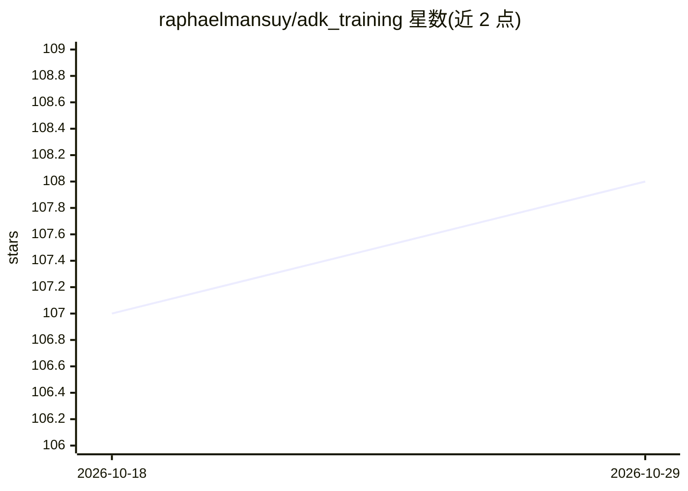

# raphaelmansuy/adk_training

⭐ 108 · Python · 推送 2026-03-01 · [GitHub](https://github.com/raphaelmansuy/adk_training) · [官网](https://raphaelmansuy.github.io/adk_training/) · 个人维护

**Google ADK 实战教程库：36 个含可运行代码的 agent 开发训练**

面向开发者的 Google ADK（Agent Development Kit）训练中心：36 个已完成教程，每篇带可运行代码与测试，覆盖工具集成、顺序/并行/多智能体工作流、状态管理、评测、流式、MCP、A2A、多模态、生产部署与 Next.js/React/Streamlit/Slack/PubSub 等 UI 和集成场景。提供三条按时间划分的学习路径（4-6 小时/2-3 天/3-5 天），另附深度博客与 TIL 短文。教程代码基于 pip 安装 google-adk，需 Python 3.9+ 与 Google Cloud API key。

## 筛选速览

| 维度 | 判定 | 备注 |
|---|---|---|
| AI 角色 | `ai-knowledge` | 知识聚合/清单类 |
| 许可风险 | `none` | — |
| 部署形态 | `library` | 以包/库形式分发 |
| 模型依赖 | — | README 未给出锁定关系 |
| 硬件要求 | — | 无带数字的原话,不猜 |
| 安装摩擦 | `low` | 无编译、无系统依赖或容器化 |
| 成熟度 | — | 结构信号不足 |

## 能力要点

- 36 个教程全部完成并附可运行代码与测试
- 三条学习路径：快速上手/产品构建/企业架构
- 覆盖 MCP、A2A、流式、多模态、评测与生产部署
- 含 UI 集成教程（Next.js/React/Streamlit/Slack/PubSub）

## 适用场景

- 系统学习用 Google ADK 构建 agent
- 查找多智能体编排与生产部署的代码模板
- 了解 ADK 的 MCP/A2A/流式等进阶特性

## 场景标签

`教程课程` `Agent 框架` `多智能体` · 领域:Agent 开发

## 证据(README 行号)

> L5: You're here because AI agents are transforming software development, and you want practical skills you can use at wo
> L18: - 36 working implementations you can run today
> L23: **Completion Status: 36/36 tutorials ready to use (100%)** ✅

## 星数曲线

2026-10-18 107 → 2026-10-29 108（+1）

---
*卡片 v1 · prompt 1.4 · 生成 2026-10-23 · 置信度 mid · 依据 README sha `b5958827097c` · [字段定义](../../DATASET.md)*
