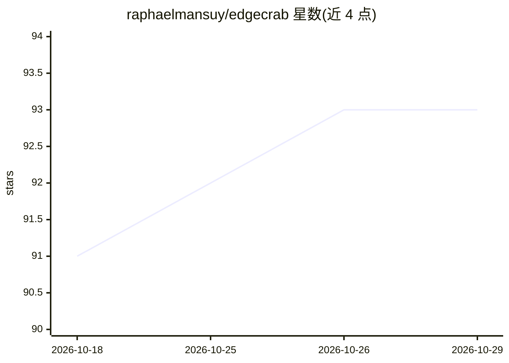

# raphaelmansuy/edgecrab

⭐ 93 · Rust · 推送 2026-07-24 · [GitHub](https://github.com/raphaelmansuy/edgecrab) · [官网](https://www.edgecrab.com) · 个人维护

**Rust 编写的终端个人助理与编码 Agent**

以原生 Rust 二进制（macOS arm64 约 49 MB，零 Python/Node 运行时依赖）分发的个人助理与编码 Agent：采用 ReAct 循环（Reason→Act→Observe，默认 90 次迭代预算），内置 16 个 LLM 提供商接入、17 个消息网关（Telegram、Discord、Slack、WhatsApp、Home Assistant 等）、持久记忆与跨会话 Honcho 用户模型、MCP 工具调用、LSP 语义代码操作、子代理与 Mixture-of-Agents 共识，并在工具执行前运行路径监狱、SSRF 防护与命令扫描。支持 Linux、macOS 与 Android(Termux)，经 npm/pip/cargo 或源码编译安装。

## 筛选速览

| 维度 | 判定 | 备注 |
|---|---|---|
| AI 角色 | `ai-native` | 本体是模型或模型工具 |
| 许可风险 | `none` | — |
| 部署形态 | `desktop` | 安装包/桌面程序 |
| 模型依赖 | local-ok | 支持本地模型 |
| 硬件要求 | — | 无带数字的原话,不猜 |
| 安装摩擦 | `low` | 无编译、无系统依赖或容器化 |
| 成熟度 | — | 结构信号不足 |

## 能力要点

- ReAct 循环 + 90 次迭代预算 + 50% 上下文窗口时自动压缩
- 内置 16 个 LLM 提供商与 17 个消息网关接入
- 工具执行前的路径监狱、SSRF 防护与命令扫描
- LSP 语义代码操作、MCP 工具调用与 Mixture-of-Agents 共识
- OpenAI 兼容代理，可向 Aider/Cline 等第三方客户端暴露配置的 LLM

## 适用场景

- 用自然语言目标让 Agent 自主执行编码与终端任务
- 在 Telegram、WhatsApp 等消息平台随时调用个人助理
- 通过 OpenAI 兼容代理把配置的模型供给第三方客户端

## 场景标签

`编码 Agent` `AI 助手` · 领域:编码与开发

## 证据(README 行号)

> L15: EdgeCrab is a **SuperAgent** — a personal assistant and coding agent forged in Rust. It carries the soul of **Nous 
> L147: EdgeCrab is an autonomous agent. Give it a goal in natural language; it reasons, calls tools, observes results, an

## 星数曲线

2026-10-18 91 → 2026-10-29 93（+2）

---
*卡片 v1 · prompt 1.4 · 生成 2026-10-23 · 置信度 mid · 依据 README sha `ede3273c0807` · [字段定义](../../DATASET.md)*
