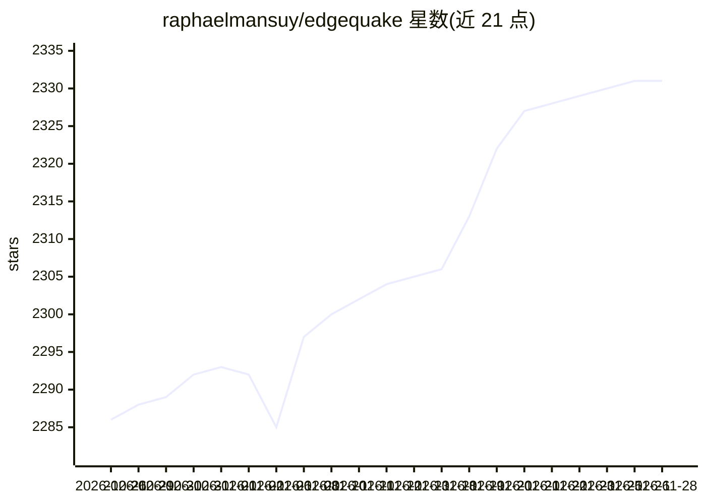

# raphaelmansuy/edgequake

⭐ 2,331 · Rust · Apache-2.0 · 推送 2026-11-24 · [GitHub](https://github.com/raphaelmansuy/edgequake) · [官网](https://edgequake.com) · 个人维护

**Rust 实现的 GraphRAG 服务：文档转知识图谱并带来源回答**

以单一 Rust 二进制 + Docker 快速启动的 GraphRAG 应用：上传 PDF 等文档后用 LLM 抽取实体与关系构建知识图谱，查询时结合向量检索（pgvector）与图遍历（Apache AGE），返回带来源的回答。提供 Web UI、REST API/Swagger、MCP server 与多语言 SDK，支持 naive/local/global/hybrid/mix 等检索模式与多租户、SSO、审计日志。数据层仅依赖 PostgreSQL，安装方式为 Docker 快速启动脚本或 make dev；本地 LLM 路径首次需拉取多 GB 模型。

## 筛选速览

| 维度 | 判定 | 备注 |
|---|---|---|
| AI 角色 | `ai-native` | 本体是模型或模型工具 |
| 许可风险 | `permissive` | Apache-2.0 |
| 部署形态 | `None` |  |
| 模型依赖 | local-ok | 支持本地模型 |
| 硬件要求 | — | 无带数字的原话,不猜 |
| 安装摩擦 | `low` | 无编译、无系统依赖或容器化 |
| 成熟度 | — | 结构信号不足 |

## 能力要点

- 单一 Rust 二进制，以 PostgreSQL（pgvector + Apache AGE）为唯一数据存储
- 实现 LightRAG 算法，六种检索模式（naive/local/global/hybrid/mix/bypass）
- Web UI 向导自动检测本地推理服务（Ollama、LM Studio、llama.cpp 等）或接入云 LLM
- PDF 处理管线：默认文本模式（内嵌 pdfium），视觉模式自动回退

## 适用场景

- 把一批 PDF/文档转成知识图谱后提问并获取带来源的回答
- 回答依赖实体间关系的问题（如人员汇报关系、合同与产品关联）
- 自托管环境下用本地 Ollama/llama.cpp 模型构建私有 RAG 服务
- 多租户团队部署带鉴权与审计的 RAG 平台

## 场景标签

`知识图谱` `RAG` `文档问答` · 领域:知识与检索

## 证据(README 行号)

> L5: > **Graph-RAG in Rust: one binary, one Postgres, any LLM — cloud or fully local.**
> L74: EdgeQuake implements the LightRAG algorithm in Rust. Documents become entities and relationships; at query time it 
> L83: Question ─► keywords ─► vector search + graph walk ─► LLM ─► answer with sources

## 星数曲线

2026-10-26 2,286 → 2026-11-28 2,331（+45）

---
*卡片 v1 · prompt 1.4 · 生成 2026-11-24 · 置信度 high · 依据 README sha `9203b5697c10` · [字段定义](../../DATASET.md)*
