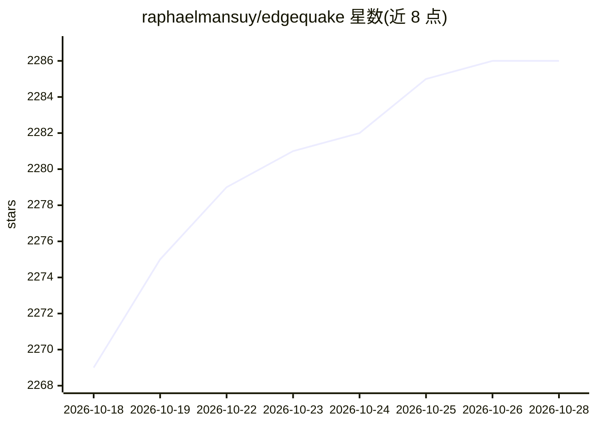

# raphaelmansuy/edgequake

⭐ 2,286 · Rust · Apache-2.0 · 推送 2026-10-27 · [GitHub](https://github.com/raphaelmansuy/edgequake) · [官网](https://edgequake.com) · 个人维护

**Rust 实现的 Graph-RAG 系统：文档转知识图谱并生成带来源回答**

用 Rust 实现 LightRAG 算法的 Graph-RAG 服务器：上传文档后经 LLM 抽取实体与关系，存入 PostgreSQL（pgvector + Apache AGE）形成知识图谱，查询时组合向量检索与图遍历，生成带来源的回答。面向需要部署生产级 RAG 的开发者：单一二进制 + Postgres，提供 Web UI、REST API、多租户隔离、认证、MCP 与多语言 SDK。LLM 可接 OpenAI/Anthropic 等云服务或 Ollama/llama.cpp 等本地运行时。需 Docker 启动。

## 筛选速览

| 维度 | 判定 | 备注 |
|---|---|---|
| AI 角色 | `ai-ecosystem` | LLM/agent 周边工具 |
| 许可风险 | `permissive` | Apache-2.0 |
| 部署形态 | `None` |  |
| 模型依赖 | local-ok | 支持本地模型 |
| 硬件要求 | — | 无带数字的原话,不猜 |
| 安装摩擦 | `low` | 无编译、无系统依赖或容器化 |
| 成熟度 | — | 结构信号不足 |

## 能力要点

- 单一 Rust 二进制 + PostgreSQL（pgvector + Apache AGE）作为唯一存储
- 六种查询模式：naive/local/global/hybrid/mix/bypass
- 向导自动发现本地模型服务器（Ollama、LM Studio、llama.cpp 等）或使用云 API key
- 提供 Python/TypeScript/Rust 等 SDK、MCP server、OpenWebUI 与 LangChain 集成
- 多租户隔离、SSO（Keycloak/OIDC）、审计日志与显式迁移

## 适用场景

- 把 PDF 等文档转为知识图谱并搭建带来源的问答服务
- 在企业内部用本地 LLM（Ollama/llama.cpp）部署私有 Graph-RAG
- 需要关系型答案（如'谁向谁汇报'）的检索场景

## 场景标签

`RAG` `知识图谱` · 领域:知识与检索

## 证据(README 行号)

> L5: > **Graph-RAG in Rust: one binary, one Postgres, any LLM — cloud or fully local.**
> L74: EdgeQuake implements the LightRAG algorithm in Rust. Documents become entities and relationships; at query time it 
> L79: Document ─► chunks ─► LLM entity + relation extraction ─► knowledge graph

## 星数曲线

2026-10-18 2,269 → 2026-10-28 2,286（+17）

---
*卡片 v1 · prompt 1.4 · 生成 2026-10-21 · 置信度 high · 依据 README sha `326caeb83fc1` · [字段定义](../../DATASET.md)*
