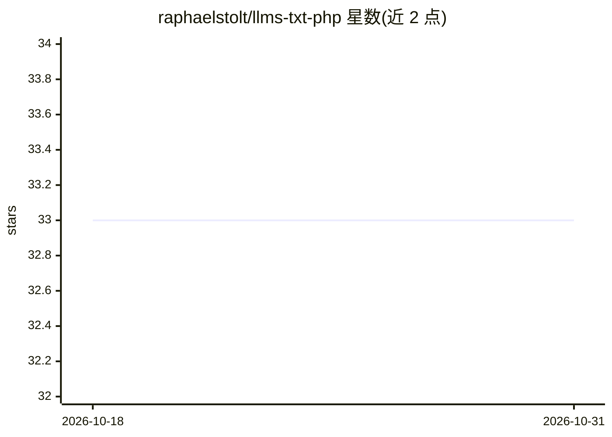

# raphaelstolt/llms-txt-php

⭐ 33 · PHP · MIT · 推送 2026-10-30 · [GitHub](https://github.com/raphaelstolt/llms-txt-php) · 个人维护

**PHP 库：创建/解析/校验/发现/展开 llms.txt 文件**

面向 PHP 应用与文档系统的 llms.txt 格式处理库：提供单一 API 创建并序列化 llms.txt 文档，解析本地文件、URL 或 Markdown 字符串（保留段落结构与空白，规范化 BOM 与换行差异），校验必需与推荐元素并输出错误/警告，按规范的 link relations 与 URL 约定发现 llms.txt 及 Markdown 资源，将链接文档展开为 XML LLM 上下文或 llms-full.txt，并支持在 HTML 中嵌入/提取 text/llms.txt 块。无 Composer 运行时依赖，可注入自定义 fetcher。配套 CLI 为独立包，需另行安装。

## 筛选速览

| 维度 | 判定 | 备注 |
|---|---|---|
| AI 角色 | `ai-ecosystem` | LLM/agent 周边工具 |
| 许可风险 | `permissive` | MIT |
| 部署形态 | `None` |  |
| 模型依赖 | — | README 未给出锁定关系 |
| 硬件要求 | — | 无带数字的原话,不猜 |
| 安装摩擦 | `low` | 无编译、无系统依赖或容器化 |
| 成熟度 | — | 结构信号不足 |

## 能力要点

- 创建、解析、校验 llms.txt 文档（含错误与警告明细）
- 基于 link relations 的 Discovery：生成/读取 alternate、describedby 链接与覆盖 URL 解析
- 链接文档展开为 XML LLM 上下文或 llms-full.txt，支持自定义 fetcher
- llms.txt 内容以 text/llms.txt script 标签嵌入 HTML 及反向提取

## 适用场景

- 为文档站点生成并校验 llms.txt 供 LLM 与 agent 读取
- 在 PHP 应用中发现并解析页面对应的 llms.txt 与 Markdown 版本
- 将站点文档展开为 LLM 上下文文件注入 AI 流程

## 场景标签

`文档解析` · 领域:知识与检索

## 证据(README 行号)

> L13: A PHP library for creating, parsing, validating, discovering, and expanding `/llms.txt` files.
> L15: Build and consume machine-readable Markdown context for LLMs and AI agents with a focused PHP API and no Composer r

## 星数曲线

2026-10-18 33 → 2026-10-31 33（+0）

---
*卡片 v1 · prompt 1.4 · 生成 2026-10-25 · 置信度 high · 依据 README sha `d11346125854` · [字段定义](../../DATASET.md)*
