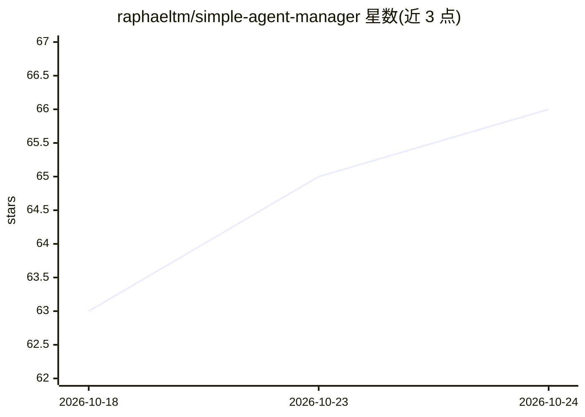

# raphaeltm/simple-agent-manager

⭐ 67 · TypeScript · AGPL-3.0 · 推送 2026-10-24 · [GitHub](https://github.com/raphaeltm/simple-agent-manager) · [官网](https://www.simple-agent-manager.org/) · 个人维护

**在自有云 VM 上并行编排多个编码 agent 的管理系统**

SAM 是一个自托管（AGPL-3.0）的编码 agent 编排平台：每个任务获得独立的 dev container 工作区，运行在用户自己的云账户 VM 上；主 agent 可通过 dispatch_task、wait_for_subtasks 等工具启动、指挥和回收 helper agent，支持 Claude Code、Codex、Gemini CLI 等多种 agent 混用。控制平面基于 Cloudflare Workers 构建，自部署需 Workers Paid 计划与 GitHub App，VM 可选多家云商，快速任务可走 Cloudflare Containers 免 VM。提供浏览器与手机端监控、定时任务与 GitHub 事件触发。

## 筛选速览

| 维度 | 判定 | 备注 |
|---|---|---|
| AI 角色 | `ai-ecosystem` | LLM/agent 周边工具 |
| 许可风险 | `viral` | AGPL-3.0 |
| 部署形态 | `library` | 以包/库形式分发 |
| 模型依赖 | — | README 未给出锁定关系 |
| 硬件要求 | — | 无带数字的原话,不猜 |
| 安装摩擦 | `low` | 无编译、无系统依赖或容器化 |
| 成熟度 | — | 结构信号不足 |

## 能力要点

- 每个任务独立 dev container 工作区，多 agent 可共享一台 VM
- agent 可启动/指挥/回收 helper agent，支持带依赖的工作流图
- Claude Code、Codex、Gemini CLI 等多种编码 agent 并行使用，可存为 profile
- 控制平面运行于 Cloudflare Workers，支持浏览器与手机端操作

## 适用场景

- 在自有云上并行运行多个编码 agent 处理任务
- 让主 agent 拆分需求并分派给多个 helper agent 执行
- 通过手机查看各 agent 状态并回答其提问
- 定时任务/GitHub 事件自动启动 agent 作业

## 场景标签

`编码 Agent` `多智能体` · 领域:Agent 开发

## 证据(README 行号)

> L3:  Run a fleet of coding agents on your own cloud.
> L28: - **The agents you already use.** Claude Code, Codex, Gemini CLI, Mistral Vibe, OpenCode, and Amp, side by side in 
> L78: |Part|What it does|Built on|

## 星数曲线

2026-10-18 63 → 2026-10-24 66（+3）

---
*卡片 v1 · prompt 1.4 · 生成 2026-10-24 · 置信度 mid · 依据 README sha `575543822b8d` · [字段定义](../../DATASET.md)*
