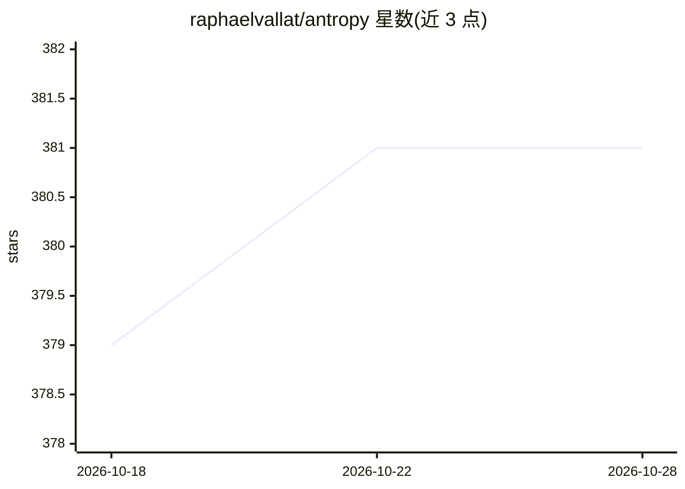

# raphaelvallat/antropy

⭐ 381 · Python · BSD-3-Clause · 推送 2026-10-24 · [GitHub](https://github.com/raphaelvallat/antropy) · [官网](https://raphaelvallat.com/antropy/) · 个人维护

**计算时间序列熵与分形维度的 Python 特征提取库**

AntroPy 是面向时间序列的熵与复杂度度量 Python 库：提供排列熵、谱熵、近似熵、样本熵、Lempel-Ziv 复杂度、Hjorth 参数，以及 Petrosian/Katz/Higuchi 分形维度、去趋势波动分析等 12 个函数；使用 Numba JIT 编译提升速度，支持 1-D 与 N-D 数组及 axis 参数处理多通道数据。典型用途包括 EEG/ECG/EMG 等生理信号的特征提取与信号处理研究，常作为机器学习管线的特征计算环节。依赖 NumPy/SciPy/scikit-learn/Numba，Python 3.10+。

## 筛选速览

| 维度 | 判定 | 备注 |
|---|---|---|
| AI 角色 | `ai-enhanced` | 去掉 AI 部分产品仍成立 |
| 许可风险 | `permissive` | BSD-3-Clause |
| 部署形态 | `library` | 以包/库形式分发 |
| 模型依赖 | — | README 未给出锁定关系 |
| 硬件要求 | — | 无带数字的原话,不猜 |
| 安装摩擦 | `low` | 无编译、无系统依赖或容器化 |
| 成熟度 | — | 结构信号不足 |

## 能力要点

- 12 个熵与分形维度函数（排列熵、样本熵、Higuchi FD、DFA 等）
- Numba JIT 编译，README 附带各函数复杂度与基准数据
- 部分函数支持 N-D 数组与 axis 参数，单次调用处理多通道数据

## 适用场景

- 从 EEG/ECG/EMG 等生理信号中提取特征
- 信号处理研究中的熵与复杂度度量
- 为机器学习管线计算时间序列特征

## 场景标签

 · 领域:信号处理/神经科学工具

## 证据(README 行号)

> L30: **AntroPy** is a Python package for computing entropy and fractal dimension measures of
> L32: both 1-D and N-D arrays. Typical use cases include feature extraction from physiological signals
> L33: (e.g. EEG, ECG, EMG), and signal processing research.

## 星数曲线

2026-10-18 379 → 2026-10-28 381（+2）

---
*卡片 v1 · prompt 1.4 · 生成 2026-10-21 · 置信度 mid · 依据 README sha `7731a68cd7b9` · [字段定义](../../DATASET.md)*
