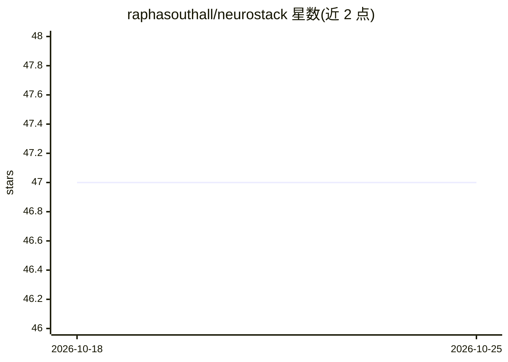

# raphasouthall/neurostack

⭐ 47 · Python · Apache-2.0 · 推送 2026-10-22 · [GitHub](https://github.com/raphasouthall/neurostack) · [官网](https://neurostack.sh) · 个人维护

**本地 Markdown 知识库的检索与优化层（CLI + MCP）**

面向已用 Markdown 记笔记的用户（Obsidian/Logseq/Notion 导出等）：将笔记文件夹索引到自带 SQLite 数据库（全文检索、嵌入、wiki 链接图），通过 CLI、33 个 MCP 工具或 OpenAI 兼容 API 向任意 MCP 客户端（Claude、Cursor、Windsurf、Gemini CLI、VS Code、Codex）提供带出处的排序证据，由用户的 AI 负责推理。间歇运行优化循环：过期笔记检测、从 AI 会话记录收割决策与经验为记忆、合并为 learnings 并排队提升为笔记。默认只读不改原文件，可选开启经 git 提交的写工具。Lite 模式无需 GPU；Full 模式经本地 Ollama 提供语义搜索，需 GPU 或 6+ 核 CPU。

## 筛选速览

| 维度 | 判定 | 备注 |
|---|---|---|
| AI 角色 | `ai-ecosystem` | LLM/agent 周边工具 |
| 许可风险 | `permissive` | Apache-2.0 |
| 部署形态 | `library` | 以包/库形式分发 |
| 模型依赖 | local-ok | 支持本地模型 |
| 硬件要求 | `cpu-ok` | |
| 安装摩擦 | `low` | 无编译、无系统依赖或容器化 |
| 成熟度 | — | 结构信号不足 |

## 能力要点

- Markdown vault 索引到独立 SQLite（FTS5 + 嵌入 + wiki 链接图）
- 通过 MCP（33 个工具）/CLI/OpenAI 兼容 API 输出带笔记路径的排序证据
- 过期笔记检测与会话收割→learnings→笔记提升的优化循环
- 默认只读、索引不改原文件，写操作经 git 提交可回滚

## 适用场景

- 让我常用的 AI 客户端直接检索并引用我的笔记库
- 在 AI 引用过时笔记前收到 stale 标记提醒
- 把 AI 会话中的决策与经验自动沉淀为可检索记忆

## 场景标签

`知识库管理` `RAG` `语义搜索` `Agent 记忆` · 领域:Agent 开发

## 证据(README 行号)

> L13: Works with Claude, Cursor, Windsurf, Gemini CLI, VS Code, Codex and any other client that supports MCP.
> L120: - Ranked evidence with note paths and excerpts over the CLI, MCP, or an OpenAI-compatible API, for your AI to cite
> L162: One OS timer runs `neurostack run-due` every minute, and that command runs each due job in turn. `neurostack serve

## 星数曲线

2026-10-18 47 → 2026-10-25 47（+0）

---
*卡片 v1 · prompt 1.4 · 生成 2026-10-25 · 置信度 high · 依据 README sha `8c625d644507` · [字段定义](../../DATASET.md)*
