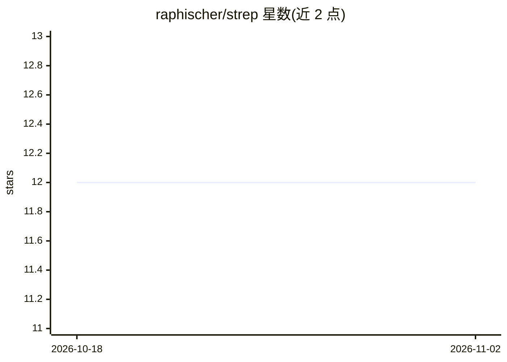

# raphischer/strep

⭐ 12 · Python · 推送 2026-06-09 · [GitHub](https://github.com/raphischer/strep) · [官网](https://github.com/raphischer/strep) · 个人维护

**ML/AI 评测数据库的可持续性与可信度报告软件**

源自博士论文的机器学习报告工具：加载 pandas DataFrame 或 mlflow 导出的评测数据库，计算 index 值与复合分数，并通过 Visualization 组件进行可视化与探索；另提供公开托管的 Exploration 工具，无需本地运行代码。附带 ImageNetEff22、EdgeAccUSB、MetaQuRe、RobustBench、Papers With Code 等预置评测数据库。以 pip 包形式发布（Python 3.8-3.12），README 声明软件处于活跃开发中、内容可能变动。

## 筛选速览

| 维度 | 判定 | 备注 |
|---|---|---|
| AI 角色 | `ai-ecosystem` | LLM/agent 周边工具 |
| 许可风险 | `none` | — |
| 部署形态 | `library` | 以包/库形式分发 |
| 模型依赖 | — | README 未给出锁定关系 |
| 硬件要求 | — | 无带数字的原话,不猜 |
| 安装摩擦 | `low` | 无编译、无系统依赖或容器化 |
| 成熟度 | `idea` | |

## 能力要点

- 从 pandas/mlflow CSV 评测数据库计算 index 值与复合分数并可视化
- 附带 ImageNetEff22、MetaQuRe、RobustBench、Papers With Code 等预置数据库
- 提供公开托管的 Exploration 工具，可在线探索数据库
- pip install strep[frontend] 安装完整功能（Python 3.8-3.12）

## 适用场景

- 在自有 ML 实验评测结果上生成可持续性与可信度评分
- 探索预置的模型效率/鲁棒性评测数据库
- 为论文或报告整理 ML 模型质量与资源消耗信息

## 场景标签

`模型评测` · 领域:评测与运维

## 证据(README 行号)

> L3: Software for **sustainable and trustworthy reporting** in machine learning and artificial intelligence, as proposed 
> L20: 1. Prepare an evaluation database as a `pandas` DataFrame OR use mlflow experiments csv export to create a `csv` fi
> L70: - `src/strep` contains software that processes the databases, calculates index values and compound scores, and visu

## 星数曲线

2026-10-18 12 → 2026-11-02 12（+0）

---
*卡片 v1 · prompt 1.4 · 生成 2026-11-01 · 置信度 high · 依据 README sha `98786278ebc8` · [字段定义](../../DATASET.md)*
