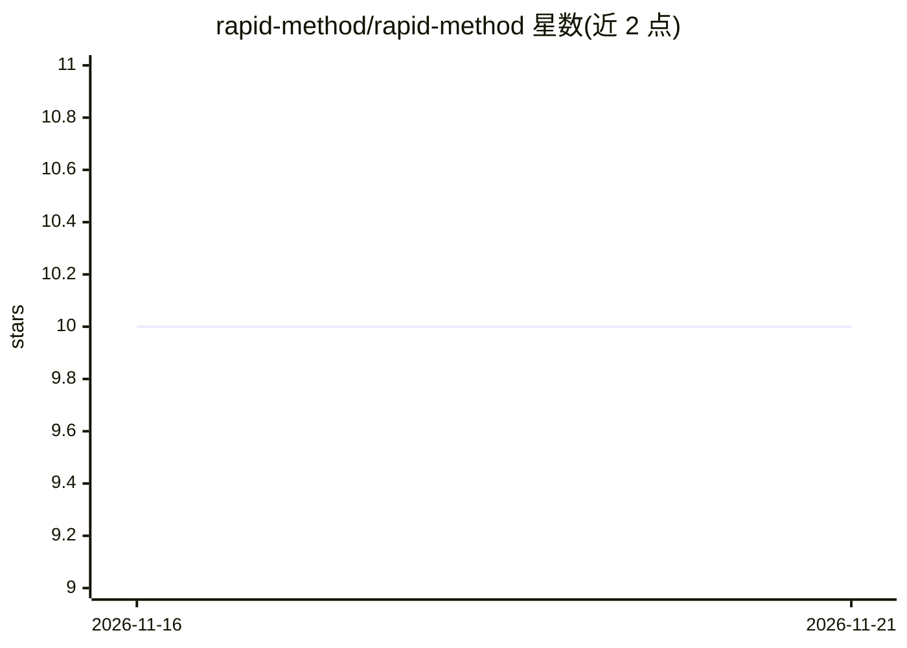

# rapid-method/rapid-method

⭐ 10 · JavaScript · MIT · 推送 2026-09-01 · [GitHub](https://github.com/rapid-method/rapid-method) · 个人维护

**面向 AI 辅助开发的规格驱动方法论 CLI，含人工审批关卡**

RAPID 是一个面向 AI 辅助开发的方法论与配套 CLI 工具，按需求-架构-模式-实现-交付流程组织工作。机制包括：先写规格再生成代码、审批后冻结意图与边界以防止范围蔓延、按复杂度在完整规格流程与一键快速路径间路由、AI 按规格自审代码并分类发现项、加载项目架构/技术栈/编码模式作为上下文。安装方式为 npx 命令配合交互式配置，技能命令在 AI IDE 中使用。前置要求 Node.js v16+，MIT 许可。

## 筛选速览

| 维度 | 判定 | 备注 |
|---|---|---|
| AI 角色 | `ai-ecosystem` | LLM/agent 周边工具 |
| 许可风险 | `permissive` | MIT |
| 部署形态 | `library` | 以包/库形式分发 |
| 模型依赖 | — | README 未给出锁定关系 |
| 硬件要求 | — | 无带数字的原话,不猜 |
| 安装摩擦 | `low` | 无编译、无系统依赖或容器化 |
| 成熟度 | — | 结构信号不足 |

## 能力要点

- 规格先行：代码生成前完成技术规格的撰写与审批
- 审批后冻结意图与边界，防止范围蔓延
- 按复杂度自动路由完整规格流程或 one-shot 快速路径
- AI 自审代码并对发现项做意图缺口/补丁/噪声分类

## 适用场景

- 给 AI 编码工作流加结构化规格与审批流程
- 管理 AI 开发过程中的需求与范围蔓延
- 为 AI 辅助项目沉淀架构文档与编码规范

## 场景标签

`工作流自动化` `代码生成` · 领域:效率与自动化

## 证据(README 行号)

> L7: **Requirements. Architecture. Patterns. Implementation. Delivery.** — A lean, spec-driven methodology for AI-assiste
> L30: Follow the interactive prompts to configure your project name, language preferences, and output paths. Then open yo
> L36: After installation, use these skills in your AI IDE:

## 星数曲线

2026-11-16 10 → 2026-11-21 10（+0）

---
*卡片 v1 · prompt 1.4 · 生成 2026-11-19 · 置信度 high · 依据 README sha `8477ea6a3eb8` · [字段定义](../../DATASET.md)*
