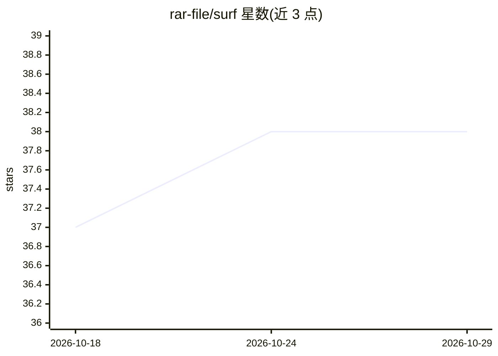

# rar-file/surf

⭐ 38 · Python · MIT · 推送 2026-05-21 · [GitHub](https://github.com/rar-file/surf) · [官网](https://surf-web-jade.vercel.app/) · 个人维护

**自托管 AI 聊天客户端：网页 UI 与终端 CLI，多模型接入**

本地优先的自托管 AI 聊天应用，提供 Flask 网页界面与终端 CLI。支持 Ollama、Anthropic、OpenAI、OpenRouter 及 OpenAI 兼容端点，可在对话中切换 provider。内置 DuckDuckGo 免 key 搜索、基于 Playwright 与视觉模型的浏览器自动化 agent、全局/会话两级持久记忆、对话摘要、Markdown 技能扩展系统、分析面板，并可将搜索能力以 MCP Server 形式暴露给 Claude Desktop。浏览器自动化与研究流等高级功能仍标注为演进中；需 Python 3.10+，本地模型依赖 Ollama，搜索与 agent 依赖 Chromium。

## 筛选速览

| 维度 | 判定 | 备注 |
|---|---|---|
| AI 角色 | `ai-native` | 本体是模型或模型工具 |
| 许可风险 | `permissive` | MIT |
| 部署形态 | `library` | 以包/库形式分发 |
| 模型依赖 | local-ok | 支持本地模型 |
| 硬件要求 | — | 无带数字的原话,不猜 |
| 安装摩擦 | `low` | 无编译、无系统依赖或容器化 |
| 成熟度 | `idea` | |

## 能力要点

- 多 provider 聊天，支持对话中 /provider 切换
- DuckDuckGo 搜索无需 API key，Playwright 驱动页面抓取
- 视觉驱动的浏览器 agent（截图→决策→点击/输入/滚动）
- Markdown 技能系统与 MCP Server 搜索工具暴露

## 适用场景

- 在一个自托管界面里切换试用本地与云端模型
- 让 agent 打开浏览器自动执行网页操作任务
- 带持久记忆与引用的联网研究问答

## 场景标签

`聊天机器人` `浏览器自动化` `网页抓取` · 领域:效率与自动化

## 证据(README 行号)

> L10: **A self-hosted AI chat with a sleek web UI and a rich terminal CLI.**
> L19: - Multi-provider chat via Ollama, Anthropic, OpenAI, OpenRouter, and compatible endpoints
> L41: Ollama (local), Anthropic Claude, OpenAI GPT, OpenRouter, or any OpenAI-compatible endpoint. Switch mid-conversatio

## 星数曲线

2026-10-18 37 → 2026-10-29 38（+1）

---
*卡片 v1 · prompt 1.4 · 生成 2026-10-25 · 置信度 mid · 依据 README sha `30253a1c73c7` · [字段定义](../../DATASET.md)*
