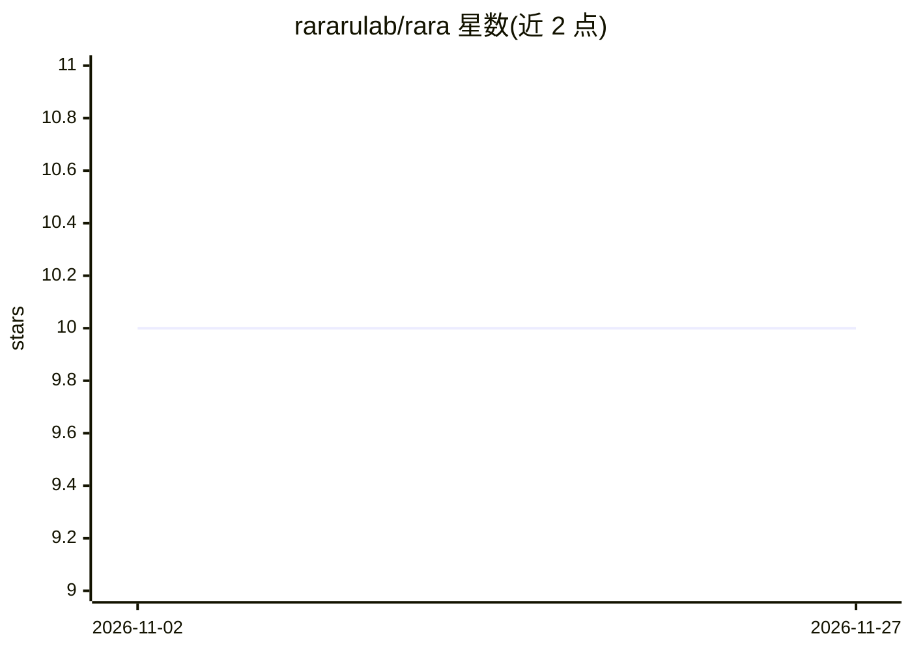

# rararulab/rara

⭐ 10 · Rust · Apache-2.0 · 推送 2026-10-15 · [GitHub](https://github.com/rararulab/rara) · [官网](https://rararulab.github.io/rara/) · 个人维护

**给 agent 提供 OS 式内核运行时的 Rust 框架**

Rust 编写的 agent 运行时框架，将 agent 类比为进程、自身定位为内核：提供生命周期调度、tape 记忆、工具访问、通道、护栏等运行机制，行为由使用者定义。支持事件循环架构（LLM、Tool、Memory、Session、Guard、EventBus）、心跳驱动的主动后台动作、可扩展技能系统与 Supervisor 网关（随 git 更新自动部署）。项目处于 WIP 阶段，API 与模块边界可能随时变动。

## 筛选速览

| 维度 | 判定 | 备注 |
|---|---|---|
| AI 角色 | `ai-ecosystem` | LLM/agent 周边工具 |
| 许可风险 | `permissive` | Apache-2.0 |
| 部署形态 | `None` |  |
| 模型依赖 | — | README 未给出锁定关系 |
| 硬件要求 | — | 无带数字的原话,不猜 |
| 安装摩擦 | `low` | 无编译、无系统依赖或容器化 |
| 成熟度 | `idea` | |

## 能力要点

- OS 式内核事件循环：LLM、Tool、Memory、Session、Guard、EventBus
- Append-only 的 tape 记忆模型（anchors、handoffs、sessions）
- 心跳驱动的主动后台动作
- 多通道 I/O：Telegram、Web、TUI、WeChat

## 适用场景

- 搭建常驻运行的主动式 agent（非仅请求-响应）
- 让同一 agent 同时接入 Telegram、Web、TUI 等多个通道
- 通过网关在 git 更新时自动部署 agent

## 场景标签

`Agent 框架` · 领域:Agent 开发

## 证据(README 行号)

> L17: Think of an agent as a **process**. Rara is its **kernel**.
> L19: An operating system doesn't tell a process what to compute — it provides scheduling, memory, I/O, and protection. R

## 星数曲线

2026-11-02 10 → 2026-11-27 10（+0）

---
*卡片 v1 · prompt 1.4 · 生成 2026-11-19 · 置信度 mid · 依据 README sha `417efb57dac1` · [字段定义](../../DATASET.md)*
