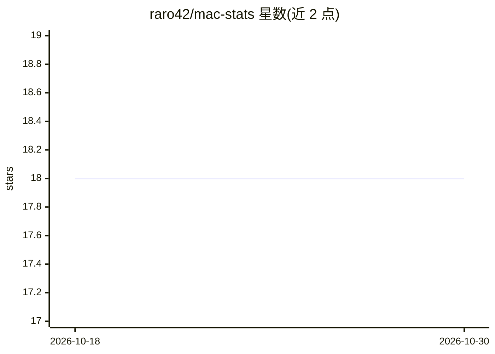

# raro42/mac-stats

⭐ 18 · Rust · MIT · 推送 2026-10-28 · [GitHub](https://github.com/raro42/mac-stats) · [官网](https://github.com/raro42/mac-stats/blob/main/docs/GETTING_STARTED.md) · 个人维护

**Apple Silicon 菜单栏系统监视器，可选本地 AI agent**

Rust + Tauri 构建的 macOS Apple Silicon（arm64）专属菜单栏监视器，显示 CPU/SSD/温度等指标，含玻璃窗口主题、进程列表、网站监控与磁盘清理面板（软删除到废纸篓）。可选启用本地 AI agent：通过 Ollama 聊天、Discord bot、调度器与 MCP 等工具，默认关闭、数据留在本机，无云端遥测。提供一键安装脚本、第三方 Homebrew tap cask 与 DMG；应用未签名需清除 Gatekeeper 隔离属性。

## 筛选速览

| 维度 | 判定 | 备注 |
|---|---|---|
| AI 角色 | `ai-enhanced` | 去掉 AI 部分产品仍成立 |
| 许可风险 | `permissive` | MIT |
| 部署形态 | `None` |  |
| 模型依赖 | local-ok | 支持本地模型 |
| 硬件要求 | — | 无带数字的原话,不猜 |
| 安装摩擦 | `low` | 无编译、无系统依赖或容器化 |
| 成熟度 | — | 结构信号不足 |

## 能力要点

- 菜单栏 CPU + SSD（及已知温度）指标，九种主题，约 0.5% 空闲 CPU 占用
- 磁盘清理面板：多作用域、默认软删除到废纸篓、启动与每 24h 自动运行
- 可选本地 Ollama AI agent（Discord、调度器、MCP、Agent Ops），默认关闭
- 无云端遥测，数据存于 ~/.mac-stats/，MIT 许可

## 适用场景

- 在菜单栏快速查看 Mac 的 CPU/SSD/温度状态
- 清理可回收磁盘空间（缓存、悬空 Docker 镜像等）
- 通过本地 Ollama 对话查询机器状态或执行 agent 任务

## 场景标签

`AI 助手` `聊天机器人` · 领域:对话与助手

## 证据(README 行号)

> L22: **Free MIT · local-first · no cloud telemetry.** Core glanceable metrics in the menu bar; optional Ollama / Discord
> L29: |Needs|macOS on Apple Silicon|+ Ollama + a model|
> L191: - Ollama chat, Discord (Werner), FETCH_URL, Brave, Perplexity, CDP browser, tasks, scheduler, MCP, Agent Ops.

## 星数曲线

2026-10-18 18 → 2026-10-30 18（+0）

---
*卡片 v1 · prompt 1.4 · 生成 2026-10-29 · 置信度 high · 依据 README sha `84277f3b0a83` · [字段定义](../../DATASET.md)*
