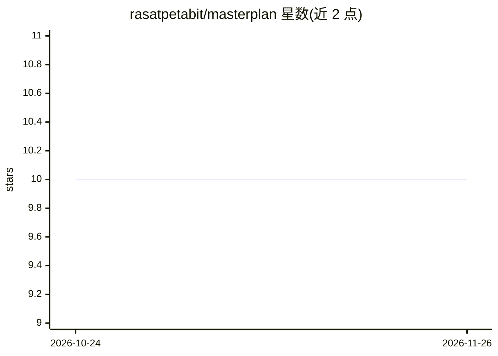

# rasatpetabit/masterplan

⭐ 10 · JavaScript · MIT · 推送 2026-11-24 · [GitHub](https://github.com/rasatpetabit/masterplan) · 个人维护

**Claude Code/Codex 插件：头脑风暴→计划→执行的开发工作流编排**

为 Claude Code 与 Codex CLI 提供的插件，通过 /masterplan 斜杠命令在 obra/superpowers 技能之上编排 brainstorm→plan→execute→finish 四阶段开发生命周期。核心机制是将状态持久化在磁盘的运行包中，会话崩溃或压缩后可无损恢复；规划阶段以确定性算法（Kahn 拓扑排序）合并任务分片，不依赖 LLM 生成最终字节；执行阶段逐波派发任务并对越界文件改动回滚。依赖上游 superpowers 核心插件。

## 筛选速览

| 维度 | 判定 | 备注 |
|---|---|---|
| AI 角色 | `ai-ecosystem` | LLM/agent 周边工具 |
| 许可风险 | `permissive` | MIT |
| 部署形态 | `None` |  |
| 模型依赖 | — | README 未给出锁定关系 |
| 硬件要求 | — | 无带数字的原话,不猜 |
| 安装摩擦 | `low` | 无编译、无系统依赖或容器化 |
| 成熟度 | — | 结构信号不足 |

## 能力要点

- 状态存于磁盘运行包，崩溃/压缩/换模型后可无损续跑
- 确定性规划：拓扑排序分配波次，plan.index.json 不由 LLM 直接生成
- D6 范围验证：越界改动自动 git 回滚并待重派
- finish 流程含验证硬停门与分支收尾门

## 适用场景

- 在 Claude Code 中管理多小时的长开发任务
- 会话中断后恢复并继续既定开发计划
- 多任务并行执行与提交前的范围审计

## 场景标签

`编码 Agent` · 领域:编码与开发

## 证据(README 行号)

> L3: > A Claude Code & Codex CLI plugin for durable multi-hour engineering work — brainstorm → plan → execute → finish on
> L9: masterplan provides the `/masterplan` slash command. It orchestrates a **brainstorm → plan → execute → finish** deve

## 星数曲线

2026-10-24 10 → 2026-11-26 10（+0）

---
*卡片 v1 · prompt 1.4 · 生成 2026-11-19 · 置信度 high · 依据 README sha `3a59222046af` · [字段定义](../../DATASET.md)*
